

```{r}
#| include: false

agenda_items <- c(
  "JavaScript graphics: packages",
  "JavaScript graphics: D3 + Claude",
  "Shiny apps",
  "Shiny extras",
  "Bonus: GitHub Pages"
)

source('setup.R')
```

---

```{r}
#| echo: false
#| results: asis

agenda(0)
```

---

```{r}
#| echo: false
#| results: asis

agenda(1)
```

---

# [Why build an interactive chart?]{.center}

::: {.col .fragment}
### The reader can...

- **Hover** for exact values
- **Filter** to the part they care about
- **Zoom** into a crowded region
- **Play** through time
- **Scroll** through a story, one step at a time
:::

::: {.col .fragment}
### The cost

- Doesn't work on paper or in a PDF
- Not easily sharable (e.g., social media)
- More to build, and more to _check_
- Hides information behind a mouse movement
:::

---

# [Two ways to make JavaScript-based graphics]{.center}

::: {.col .fragment}

### [A.]{.orange} Packages that wrap JavaScript

[`plotly`, `reactable`]{.center}

- Hide the JavaScript behind R code
- Short, readable code you could write yourself
- Limited to what the package supports
:::

::: {.col .fragment}

### [B.]{.orange} Custom graphics with D3

[`D3` + Claude]{.center}

- Build **anything** you can describe
- You don't write it by hand: you [prompt and iterate]{.orange}
- You verify the result against a static chart and the data
:::

---

## [Plotly](https://plotly.com/graphing-libraries/) uses JavaScript to create interactive charts

. . .

### But you don't have to know JavaScript to use it! 🎉

---

### Turn any ggplot into an interactive chart with `ggplotly()`

::: {.col .font65}
```{r}
#| eval: false

plot <- gapminder %>%
  filter(year == 2007) %>%
  ggplot(aes(x = gdpPercap, y = lifeExp,
             size = pop, color = continent,
             label = country)) +
  geom_point(alpha = 0.7) +
  scale_color_brewer(palette = 'Set2') +
  scale_size_area(
    guide = FALSE, max_size = 25) +
  scale_x_log10() +
  theme_bw(base_size = 16) +
  labs(x = 'GDP per capita',
       y = 'Life expectancy',
       color = 'Continent')

plot
```
:::

::: {.col}
```{r}
#| echo: false
#| fig-width: 7
#| fig-height: 5

plot <- gapminder %>%
  filter(year == 2007) %>%
  ggplot(aes(x = gdpPercap, y = lifeExp,
             size = pop, color = continent,
             label = country)) +
  geom_point(alpha = 0.7) +
  scale_color_brewer(palette = 'Set2') +
  scale_size_area(
    guide = FALSE, max_size = 25) +
  scale_x_log10() +
  theme_bw(base_size = 16) +
  labs(x = 'GDP per capita',
       y = 'Life expectancy',
       color = 'Continent')

plot
```
:::

---

### Turn any ggplot into an interactive chart with `ggplotly()`

::: {.col}
```{r}
#| eval: false

ggplotly(plot)
```
:::

::: {.col}
```{r}
#| echo: false

# Embedding as a iframe since direct rendering produces poor results, see
# https://github.com/rstudio/htmltools/issues/90
htmltools::tags$iframe(
  src         = file.path('figs', 'gapminder.html'),
  width       = "100%",
  height      = "400",
  scrolling   = "no",
  seamless    = "seamless",
  frameBorder = "0"
)
```
:::

---

### Control what the tooltip shows with the `tooltip` argument

::: {.col}
```{r}
#| eval: false
#| code-line-numbers: "3"

ggplotly(
  plot,
  tooltip = c("country", "pop")
)
```
:::

::: {.col}
```{r}
#| echo: false

htmltools::tags$iframe(
  src         = file.path('figs', 'gapminder_tooltip.html'),
  width       = "100%",
  height      = "400",
  scrolling   = "no",
  seamless    = "seamless",
  frameBorder = "0"
)
```
:::

---

# `ggplotly()` is a _translation_

# Translations lose things

. . .

- **Tooltips** often show raw aesthetic names (`x`, `y`, `colour`) and unrounded numbers
- **Subtitles, captions, and annotations** can move or vanish
- **Fonts and themes** don't always survive
- **Legends** can be duplicated or oddly placed

. . .

<br>

### Always compare the interactive version to the static one

---

### Save as html page

```{r}
#| eval: false

htmlwidgets::saveWidget(
  ggplotly(plot),
  file = file.path('figs', 'gapminder.html')
)
```

. . .

<br>

### Insert using iframe (same thing we'll do with D3!)

```{r}
#| eval: false

htmltools::tags$iframe(
  src         = file.path('figs', 'gapminder.html'),
  width       = "100%",
  height      = "400",
  scrolling   = "no",
  seamless    = "seamless",
  frameBorder = "0"
)
```

---

## Interactive _tables_: `reactable::reactable()`

::: {.col width="40%"}
```{r}
#| eval: false
#| code-line-numbers: "4"

library(reactable)

gapminder %>%
  reactable()
```
:::

::: {.col width="60%"}
```{r}
#| echo: false

htmltools::tags$iframe(
  src         = file.path('figs', 'gapminder_reactable.html'),
  width       = "100%",
  height      = "500",
  scrolling   = "yes",
  seamless    = "seamless",
  frameBorder = "0"
)
```
:::

---

## `reactable()` has some nice [options](https://glin.github.io/reactable/articles/examples.html)!

::: {.col .font60 width="40%"}
```{r}
#| eval: false
#| code-line-numbers: "5,6,7,8,9,10"

library(reactable)

gapminder %>%
  reactable(
    searchable = TRUE,
    highlight = TRUE,
    filterable = TRUE,
    defaultPageSize = 5,
    showPageSizeOptions = TRUE,
    pageSizeOptions = c(5, 10, 15)
  )
```
:::

::: {.col width="60%"}
```{r}
#| echo: false

htmltools::tags$iframe(
  src         = file.path('figs', 'gapminder_reactable_options.html'),
  width       = "100%",
  height      = "500",
  scrolling   = "yes",
  seamless    = "seamless",
  frameBorder = "0"
)
```
:::

---

# You don't need to memorize any of this

### Ask your AI agent for what you need, then check the result, e.g.:

- Do the numbers in the tooltips match the data?
- Did anything from the static version get lost?
- Is the interactive version actually better?

---



```{r}
#| echo: false

countdown(
  minutes = 8,
  warn_when = 30,
  update_every = 15,
  top = '0.5em',
  right = '0.5em',
  font_size = '2em'
)
```

## Your Turn: Interactive Charts & Tables

1. Open `practice.qmd`
2. Take a chart from a past class or homework and make it interactive with `ggplotly()`, **or** make a `reactable()` table of the gapminder data
3. Check the tooltips, and compare against the static version
4. Post your favorite in Slack

---

```{r}
#| echo: false
#| results: asis

agenda(2)
```

---





# B. When packages aren't enough

---

# What packages can't do easily

::: {.col}
- A **custom scale** or axis
- A **custom animation** (not just "play through the frames")
- A bespoke interaction: linked views, brushing, step-by-step stories
- A layout nobody wrote a function for
:::

::: {.col}
### [D3](https://d3js.org/)

- The JavaScript library underneath most custom interactive graphics (The Pudding, NYT, The Guardian)
- It can build **anything**, so it's much more complex than `ggplotly()`
- Browse the [D3 Graph Gallery](https://d3-graph-gallery.com/) to see what's possible
:::

---

# You don't write D3. You prompt, and iterate.

::: {.col}
### [You]{.orange .center}
- Decide what the chart should show
- Describe it **precisely**
- Check that it's right
:::

::: {.col}
### [Claude]{.orange .center}
- Writes the JavaScript
- Revises until it looks right
:::

. . .

<br>

### How do you verify it without reading the code?

---

# Verify against the data, not the code

1. Build a **static chart** first and check it carefully (your ggplot, or a plotly version)
2. Prompt Claude to bring that same chart to life as an interactive, animated version
3. **Compare** the interactive chart to the static one, and to the data

. . .

<br>

### The static chart is your reference

---

# The workflow

1. [Make a static chart]{.orange} and verify it
2. [Sketch]{.orange} what the interactive version should do
3. [Prompt]{.orange} Claude with your code, your data, and your sketch
4. [Iterate]{.orange} until it looks right
5. [Verify]{.orange} against the static chart and the data

---

### Example, step 1: a static chart we've already verified

::: {.col}
```{r}
#| echo: false
#| fig-width: 7
#| fig-height: 5

plot
```
:::

::: {.col}
**What we know from the data:**

- 142 countries in 2007
- China and India are the biggest bubbles
- Life expectancy ranges from about 40 to 83 years
:::

---

### Example, steps 2-3: the prompt

::: {.font85}
> Here is my static chart (code below) and the data (`gapminder.csv`). Build an **animated, interactive version in D3**:
>
> - One bubble per country, same axes and colors as the static chart
> - A **year slider** (1952-2007) and a **play button** that animates between years
> - **Continent filter** buttons, and a **tooltip** on hover
> - A title that states the main takeaway
>
> Put it in a single self-contained file called `d3-chart.html`, loading D3 from a CDN. **Embed the data directly in the file.**
:::

---

### Example, step 4: the result

<iframe src="d3/gapminder-slider.html" width="100%" height="650" style="border:none;"></iframe>

---

### Example, step 5: verify against the static chart and the data

::: {.col}
1. Set the slider to **2007**: does it match the static chart?
2. **Hover** over a bubble: do the values match the data?
3. **Count** the bubbles: 142?
4. Check the **axes**: ranges, units, labels
5. Click **everything**: first and last year, each filter
:::

::: {.col .font60}
```{r}
gapminder %>%
  filter(country == "China", year == 2007)
```

```{r}
gapminder %>%
  filter(year == 2007) %>%
  nrow()
```
:::

---

# Checks for any chart you didn't write by hand

1. **The numbers.** Hover over several points and compare to your data
2. **The axes.** Units? Start points? Resize the window: does it still work?
3. **The claim.** Does the data support exactly what the title says?
4. **The interaction.** Does every control do what it says?

. . .

<br>

### If something looks off, tell Claude exactly what's wrong and give it the right value from your data

---

# Gotchas

1. **Embed the data in the file.** A local `.html` can't load a local CSV (browsers block it), and the chart will be blank
2. **Open it in the browser** and check the console (right-click → Inspect → Console) for red errors
3. To embed in a `.qmd`, the `.html` must be **in the same folder** and **committed**:

::: {.font80}
```html
<iframe src="d3-chart.html" width="100%" height="500" style="border:none;"></iframe>
```
:::

---



```{r}
#| echo: false

countdown(
  minutes = 20,
  warn_when = 60,
  update_every = 15,
  top = '0.5em',
  right = '0.5em',
  font_size = '2em'
)
```

## Your Turn: A Custom Chart in D3

1. Make a **static chart** (any data set) and check it
2. **Sketch** the interactive version: what moves, what hovers, what filters?
3. **Prompt** Claude to build it in `d3-chart.html`
4. **Verify** it against your static chart and the data
5. **Embed** it in `practice.qmd` with an iframe

Fast finishers: add a second interaction

---




```{r}
#| echo: false

countdown(
  minutes = 5,
  warn_when = 30,
  update_every = 1,
  left = 0, right = 0, top = 1, bottom = 0,
  margin = "5%",
  font_size = "8em"
)
```

# Intermission

---

```{r}
#| echo: false
#| results: asis

agenda(3)
```

---




# License

## These slides were modified from [Florencia D'Andrea](https://florencia.netlify.app/)'s [RLadies Shiny Meetup Slides](https://github.com/flor14/rladies_shiny_meetup_2020)

This work is licensed under a</br>[Creative Commons Attribution-ShareAlike 4.0](http://creativecommons.org/licenses/by-sa/4.0/) International License

---

# New libraries to install

```{r}
#| eval: false

install.packages('shiny')
install.packages('shinyWidgets')
install.packages('rsconnect')
```

---




::: {.col width="40%"}
{width="300"}
:::

::: {.col width="60%"}
</br>

# Interactive Webapps in R

## Check out the [Shiny Gallery](https://shiny.rstudio.com/gallery/)
:::

---

# Anatomy of a Shiny App

A Shiny app is a web page (UI) connected to a computer running a live R session (Server)

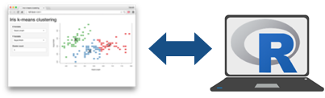{width="860" .nostretch}

---

# `app.R`

::: {.col width="45%"}
You can insert all the code at once with the shinyapp snippet!

Just start typing `shiny`...

```{r}
#| echo: false
#| fig-align: center
#| out-width: '80%'

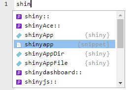
```
:::

::: {.col width="55%"}
```{r}
#| eval: false

library(shiny)

ui <- fluidPage(

)

server <- function(input, output, session) {

}

shinyApp(ui, server)
```
:::

---

# Building a shiny app

{width="800" .nostretch}

::: {.col}
**`ui`**

1. Pick a layout function

2. Add inputs widgets

3. Add `*Output()` functions
:::

::: {.col}
**`server`**

1. Use `render*()` functions to make outputs

2. Link outputs with `output$<id>`

3. Link inputs with `input$<id>`
:::

---

# Run the app 🎬

- **Option 1**: Click the "Run App" button in the toolbar:

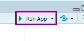{width="360" .nostretch}

- **Option 2**: Use a keyboard shortcut: Cmd/Ctrl + Shift + Enter.

- **Option 3**: `shiny::runApp()` with the path to the **app.R** file.

---



::: {.col width="40%"}
## Your Turn

### `hello_shiny.app`

Create a new file called `app.R` in Positron, then copy in this code
:::

::: {.col .font50 width="60%"}
```{r}
#| eval: false
#| code-line-numbers: "1,4,27,40"

library(shiny)

# Define UI for application that draws a histogram
ui <- fluidPage(

    # Application title
    titlePanel("Old Faithful Geyser Data"),

    # Sidebar with a slider input for number of bins
    sidebarLayout(
        sidebarPanel(
            sliderInput("bins",
                        "Number of bins:",
                        min = 1,
                        max = 50,
                        value = 30)
        ),

        # Show a plot of the generated distribution
        mainPanel(
           plotOutput("distPlot")
        )
    )
)

# Define server logic required to draw a histogram
server <- function(input, output) {

    output$distPlot <- renderPlot({
        # generate bins based on input$bins from ui.R
        x    <- faithful[, 2]
        bins <- seq(min(x), max(x), length.out = input$bins + 1)

        # draw the histogram with the specified number of bins
        hist(x, breaks = bins, col = 'darkgray', border = 'white')
    })
}

# Run the application
shinyApp(ui = ui, server = server)
```
:::

---




## User Interface (UI)

```{r}
#| echo: false
#| fig-align: center
#| out-width: '70%'


```

[Matryoshka Dolls](https://en.wikipedia.org/wiki/Matryoshka_doll)

---



### Organize panels and elements into a layout with a **layout function**

### Top level is usually `fluidPage()`

```{r}
#| echo: false
#| fig-align: center
#| out-width: '80%'

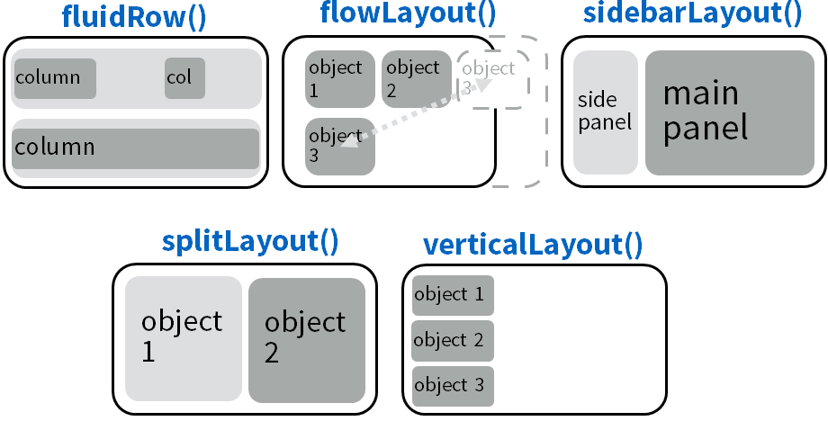
```

---



```{r}
#| echo: false
#| fig-align: center
#| out-width: '100%'

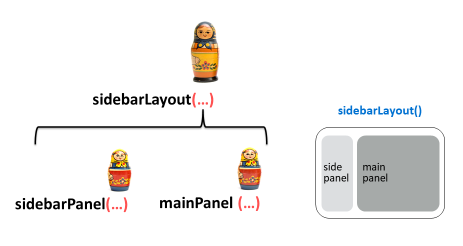
```

---

### `sidebarLayout()`

::: {.col width="40%"}
```{r}
#| eval: false
#| code-line-numbers: "5,7,14"

ui <- fluidPage(

  titlePanel("Hello Shiny!"),

  sidebarLayout(

    sidebarPanel(
      sliderInput(
        "bins", label = "Number of bins:",
        min = 1, value = 30, max = 50
      )
    ),

    mainPanel(
      plotOutput("distPlot")
    )
  )
)
```
:::

::: {.col width="60%"}
```{r}
#| echo: false
#| fig-align: center
#| out-width: '100%'

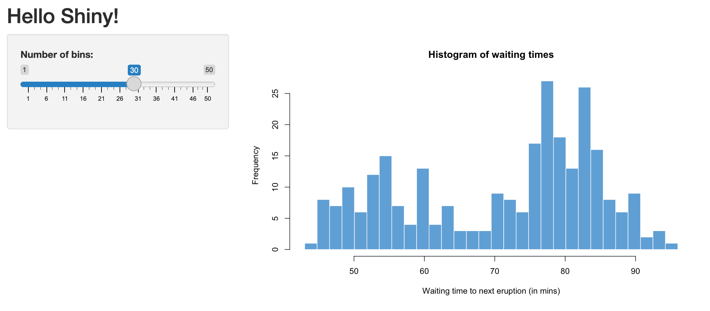
```
:::

---

### `navbarPage()`: An alternative to `fluidPage()`

Think of each `tabPanel()` as it's own `fluidPage()`

::: {.col width="40%"}
```{r}
#| eval: false
#| code-line-numbers: "1"

ui <- navbarPage("My Application",
  tabPanel("Component 1"),
  tabPanel("Component 2"),
  tabPanel("Component 3")
)
```
:::

::: {.col width="60%"}
```{r}
#| echo: false
#| fig-align: center
#| out-width: '100%'

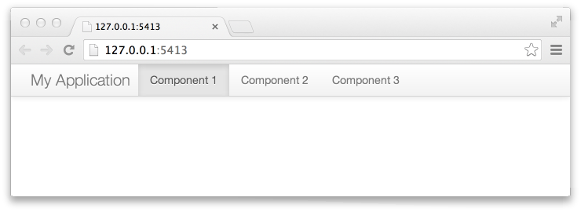
```
:::

---

### `navbarPage()`: An alternative to `fluidPage()`

Use `navbarMenu()` to create a nested menu item

::: {.col width="40%"}
```{r}
#| eval: false
#| code-line-numbers: "4,5,6"

ui <- navbarPage("My Application",
  tabPanel("Component 1"),
  tabPanel("Component 2"),
  navbarMenu("More",
    tabPanel("Sub-Component A"),
    tabPanel("Sub-Component B"))
)
```
:::

::: {.col width="60%"}
```{r}
#| echo: false
#| fig-align: center
#| out-width: '100%'

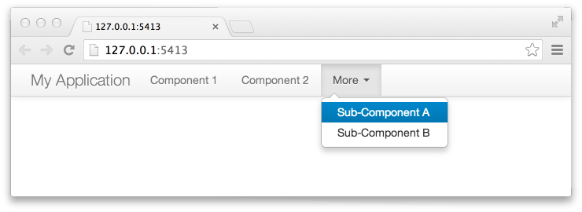
```
:::

---




# The UI defines the "what" and "where" for:

## 1. **[Inputs]{.orange}**: collect values from the user
## 2. **Output**: display something to the user

---



# **Inputs**: collect values from the user

```{r}
#| echo: false
#| fig-align: center
#| out-width: '100%'

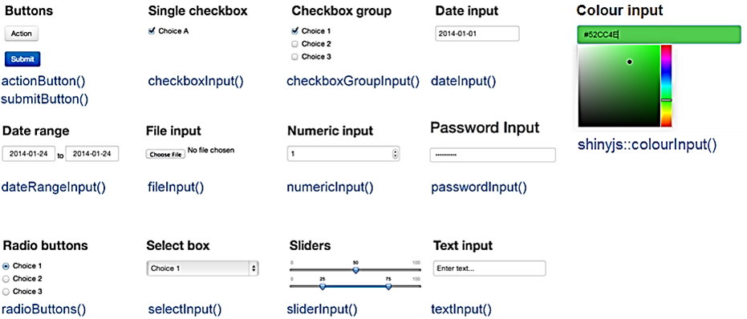
```

---

## Example Input: Radio buttons in the sidebar

::: {.col width="30%"}
```{r}
#| eval: false
#| code-line-numbers: "4"

ui <- fluidPage(
  sidebarLayout(
    sidebarPanel(
      radioButtons(…)
    ),
    mainPanel(…)
  )
)
```
:::

::: {.col width="70%"}
```{r}
#| echo: false
#| fig-align: center
#| out-width: '100%'

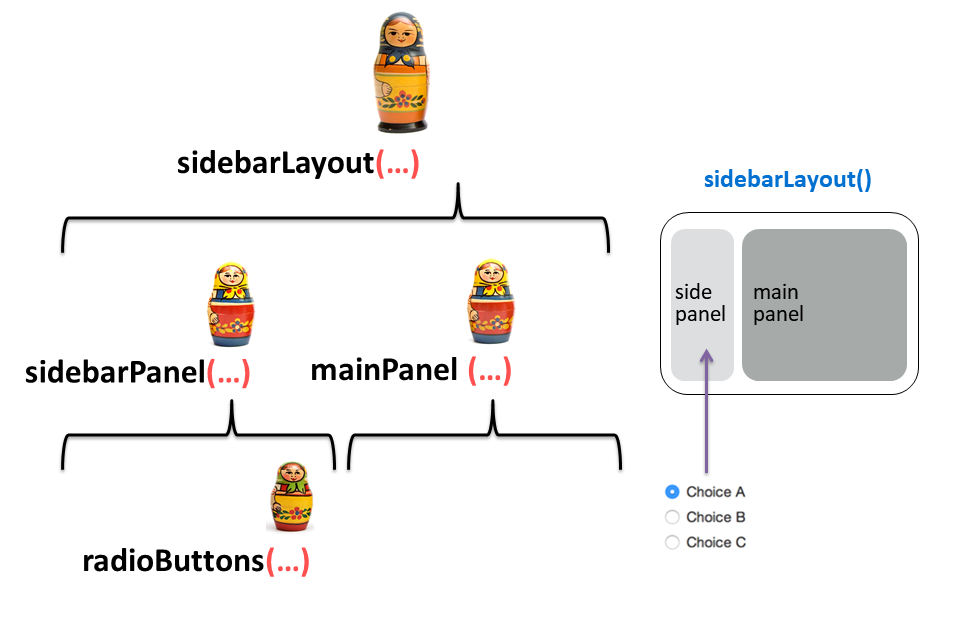
```
:::

---





```{r}
#| echo: false
#| fig-align: center
#| out-width: '70%'


```

---





```{r}
#| echo: false
#| fig-align: center
#| out-width: '90%'

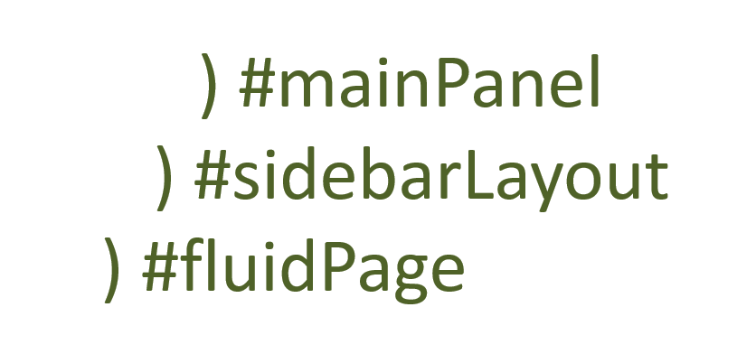
```

---



## Quick practice

1. Open the `widgets.R` file.
2. Run the app (Click "run app" button).
3. Go to the [Shiny Widgets Gallery](https://shiny.rstudio.com/gallery/widget-gallery.html) to see other input widgets.

---




# The UI defines the "what" and "where" for:

## 1. **Inputs**: collect values from the user
## 2. **[Output]{.orange}**: display something to the user

---

## Example Output: Put a plot in the main panel

::: {.col width="30%"}
```{r}
#| eval: false
#| code-line-numbers: "7"

ui <- fluidPage(
  sidebarLayout(
    sidebarPanel(
      radioButtons(…)
    ),
    mainPanel(
      plotOutput(…)
    )
  )
)
```
:::

::: {.col width="70%"}
```{r}
#| echo: false
#| fig-align: center
#| out-width: '100%'

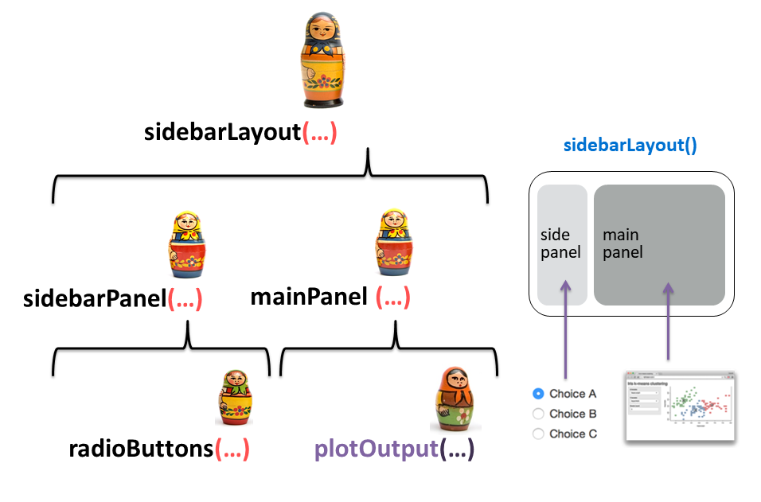
```
:::

---

# **Output**: display something to the user

Output function  | Description
-----------------| ---------------
`plotOutput()`   | Display a reactive _plot_
`dataTableOutput()` | Display a `DT::datatable()`
`textOutput()`   | Display reactive _text_
`imageOutput()`  | Display an image

---

# Building a shiny app

{width="800" .nostretch}

::: {.col}
**`ui`**

1. Pick a layout function, e.g. `sidebarLayout()`

2. Add inputs widgets

3. Add `*Output()` functions
:::

::: {.col}
**`server`**

1. Use `render*()` functions to make outputs

2. Link outputs with `output$<id>`

3. Link inputs with `input$<id>`
:::

---



```{r}
#| echo: false
#| fig-align: center
#| out-width: '90%'

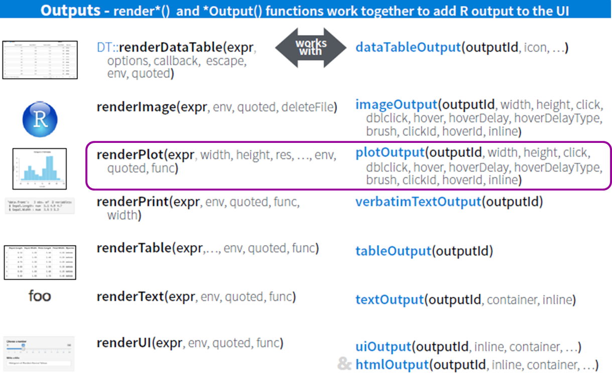
```

---

# Using `renderPlot()`: make a plot

::: {.col}
```{r}
#| eval: false

library(ggplot2)

ggplot(mpg) +
  geom_point(
    aes(x = displ, y = hwy, color = class))
```
:::

::: {.col}
```{r}
#| echo: false
#| fig-width: 7
#| fig-height: 5
#| fig-align: center

library(ggplot2)

ggplot(mpg) +
  geom_point(
    aes(x = displ, y = hwy, color = class))
```
:::

---

## Link plot to output with `output$<id>`

::: {.col width="45%"}
`ui`

```{r}
#| eval: false
#| code-line-numbers: "7,8,9"

ui <- fluidPage(
  sidebarLayout(
    sidebarPanel(
      radioButtons(…)
    ),
    mainPanel(
      plotOutput(
        outputId = "mpg_plot"
      )
    )
  )
)
```
:::

::: {.col width="55%"}
`server`

```{r}
#| eval: false
#| code-line-numbers: "2"

server <- function(input, output, session) {
  output$mpg_plot <- renderPlot({
    ggplot(mpg) +
      geom_point(
        aes(x = displ, y = hwy, color = class))
  })
}
```
:::

---

## Link user inputs to plot with `input$<id>`

::: {.col .font60}
`ui`

```{r}
#| eval: false
#| code-line-numbers: "5,9,10,11"

ui <- fluidPage(
  sidebarLayout(
    sidebarPanel(
      radioButtons(
        inputId = "xvar",
        label = "Select the x-axis variable:",
        selected = "displ",
        choices = c(
          "Highway miles per gallon" = "hwy",
          "City miles per gallon" = "cty",
          "Engine displacement, in litres" = "displ")
      ),
    ),
    mainPanel(
      plotOutput(
        outputId = "mpg_plot"
      )
    )
  )
)
```
:::

::: {.col .font60}
`server`

```{r}
#| eval: false
#| code-line-numbers: "5,6"

server <- function(input, output, session) {
  output$mpg_plot <- renderPlot({
    ggplot(mpg) +
      geom_point(
        aes_string(
          x = input$xvar,
          y = "hwy",
          color = "class"))
  })
}
```

**Note**: I switched the ggplot code from</br>`aes()` to `aes_string()`
:::

---



## Quick practice

Open the `mpg.R` app and click the "Run App" button

---



```{r}
#| echo: false

countdown(
  minutes = 10,
  warn_when = 30,
  update_every = 15,
  top = '0.5em',
  right = '0.5em',
  font_size = '2em'
)
```

## Your Turn

::: {.col}
1. Open the `caseConverter.R` file.
2. In the `server`: Write code in the provided `renderText()` to convert the input text to lower case.
3. Run the app and test that it's working.
4. In the `ui` main panel: Add two more `textOutput()` functions for also displaying the input text in "upper" case and "title" case.
3. In the `server`: Define two more outputs to convert the input text to "upper" case and "title" case.
:::

::: {.col}
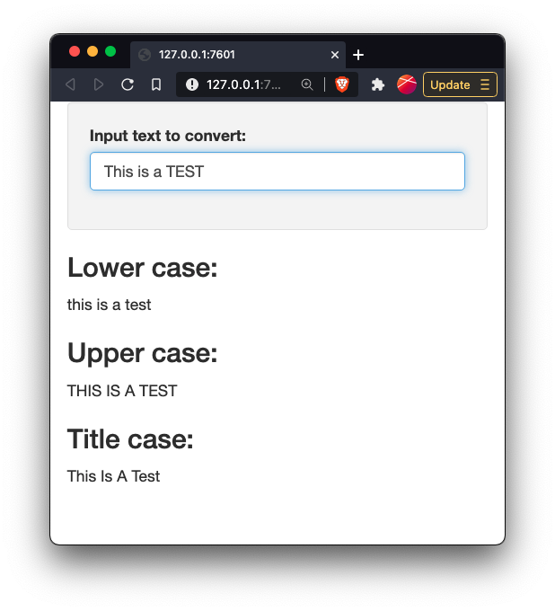{width="660"}
:::

---

```{r}
#| echo: false
#| results: asis

agenda(4)
```

---




## Add a theme with ["shinythemes"](https://rstudio.github.io/shinythemes/) package

```{r}
#| echo: false
#| fig-align: center
#| out-width: '60%'

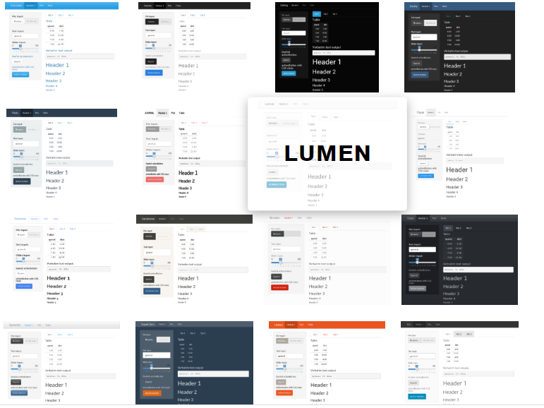
```

---

### [Insert theme at top of main `ui` layout function]{.center}

::: {.col width="40%"}
```{r}
#| eval: false
#| code-line-numbers: "4"

library(shinythemes)

ui <- fluidPage(
  theme = shinytheme("sandstone"),
  sidebarLayout(
    sidebarPanel(
      <insert widgets>
    ),
    mainPanel(
      <insert outputs>
    )
  )
)
```
:::

::: {.col width="60%"}
```{r}
#| echo: false
#| fig-align: center
#| out-width: '100%'

knitr::include_graphics("https://rstudio.github.io/shinythemes/images/sandstone.png")
```
:::

---




## Fancier widgets with ["shinyWidgets"](http://shinyapps.dreamrs.fr/shinyWidgets/) package

### Open the `shinyWidgets.R` app and click the "Run App" button

---

# If you really want to get good at this:

## 1. Print out this [Cheatsheet](https://shiny.posit.co/r/articles/start/cheatsheet/)

## 2. Watch this [2.5 Hour Comprehensive RStudio Tutorial](https://shiny.rstudio.com/tutorial)

## 3. Use this reference manual: [Mastering Shiny](https://mastering-shiny.org/)

---

# You can deploy an app for free on [Posit Connect Cloud](https://connect.posit.cloud)

(shinyapps.io is being retired in favor of Connect Cloud)

1. Sign in at [connect.posit.cloud](https://connect.posit.cloud) with GitHub
2. Put your app in a **public GitHub repo**: `app.R` + any data files
3. In R, in the app folder, list the packages the app needs:

```{r}
#| eval: false

rsconnect::writeManifest()
```

4. Commit and push `manifest.json` with the app
5. On Connect Cloud: **Publish → Shiny → your repo → `app.R` → Publish**

---

# Deploy: things that bite

- No `manifest.json`, or a **stale** one → missing package error. Re-run `writeManifest()`, push, republish
- Data files must be **committed** next to `app.R`, and read with relative paths
- Don't call `install.packages()` inside the app
- "Automatically publish on push" redeploys every time you push

---



```{r}
#| echo: false

countdown(
  minutes = 15,
  warn_when = 30,
  update_every = 15,
  top = '0.5em',
  right = '0.5em',
  font_size = '2em'
)
```

## Your Turn

::: {.col width="80%"}
1. Open the `internetUsers.R` file.
2. Modify the server code so that the inputs control the plot.
3. (Optional) Deploy your app to Posit Connect Cloud
:::

::: {.col width="20%"}
:::


---

```{r}
#| echo: false
#| results: asis

agenda(5)
```

<!-- BONUS: only if there is time. Otherwise demo it, or skip and point to the
     steps in practice.qmd. -->

---

# Bonus: publish your JavaScript graphic on the web

You can take your Quarto file with the D3 (or plotly) graphic and put it on a real URL with **GitHub Pages**

. . .

1. Create a new **public** repo (GitHub Desktop)
2. Add your `.qmd` and graphic files, plus a `_quarto.yml` that renders into `docs/`
3. **Render**, then commit and **push**
4. On GitHub.com: Settings → Pages → deploy from `main` / `docs`
5. Open `https://<username>.github.io/<repo>/`

---

# The key setting: render into `docs/`

::: {.font80}
```yaml
# _quarto.yml
project:
  type: website
  output-dir: docs        # default is _site
  resources:
    - d3-chart.html       # copy your D3 file into docs/
```
:::

. . .

The `pages-demo` folder in your practice files has a starter: `index.qmd`, `_quarto.yml`, and a hidden `.nojekyll` file (in Finder: Cmd+Shift+.)

---

# Three things everyone forgets

1. [**Turn Pages on.**]{.orange} It's off by default
2. [**Render before you push.**]{.orange} Pages serves what's committed, so a stale or missing `docs/` means a stale or missing site
3. [**Make the repo public.**]{.orange}

. . .

### And every time you change something: re-render, commit, push

---



```{r}
#| echo: false

countdown(
  minutes = 15,
  warn_when = 60,
  update_every = 15,
  top = '0.5em',
  right = '0.5em',
  font_size = '2em'
)
```

## Optional: Publish Your D3 Chart

1. Create a public repo, and copy in the `pages-demo` files and your `d3-chart.html`
2. Render, commit, push
3. Turn on Pages, then **post your live URL in Slack**

---





# Next week: Story-telling
