<!-- Title slide -->

::: {.col width="30%"}

<center>

</center>

:::

::: {.col width="70%" valign="middle"}






# []{.fancy}

###  

###  

###  

:::


---




::: {.col width="20%"}
:::

::: {.col width="80%"}
## "At the heart of quantitative reasoning is a single question: **Compared to what?**"

## -- Edward Tufte
:::

---

## Today's data


::: {.cell}

```{.r .cell-code  code-line-numbers="5"}
college_all_ages <- read_csv(file.path('data', 'college_all_ages.csv'))
gapminder <- read_csv(file.path('data', 'gapminder.csv'))
marathon <- read_csv(file.path('data', 'marathon.csv'))
milk_production <- read_csv(file.path('data', 'milk_production.csv'))
internet_regions <- read_csv(file.path('data', 'internet_users_region.csv'))
```
:::


<br>

## New packages


::: {.cell}

```{.r .cell-code}
install.packages("ggrepel")
install.packages("ggridges")
```
:::


---





# Week 9: [Comparisons]{.fancy}

<div style="height: 1.5em;"></div>

### 1. Comparing to a reference

### 2. Comparing variables

### 3. Comparing distributions

---





# Week 9: [Comparisons]{.fancy}

<div style="height: 1.5em;"></div>

### 1. [Comparing to a reference]{.orange}

### 2. Comparing variables

### 3. Comparing distributions

<!--
Comparing things to a reference line:
- Add a simple line
- diverging bars / lollipops,

- In any of these plots, adding a benchmark can be really useful
- Another way is to compare things to a **computed** benchmark, like the mean - diverging bars / lollipops
-->

---



## [For this section, we'll be using this data frame:]{.center}


::: {.cell}

```{.r .cell-code}
gapminder_americas <- gapminder %>%
  filter(continent == "Americas", year == 2007) %>%
  mutate(country = fct_reorder(country, lifeExp))
```
:::


---



## Use reference lines to add context to chart

::: {.col}

::: {.cell layout-align="center"}
::: {.cell-output-display}
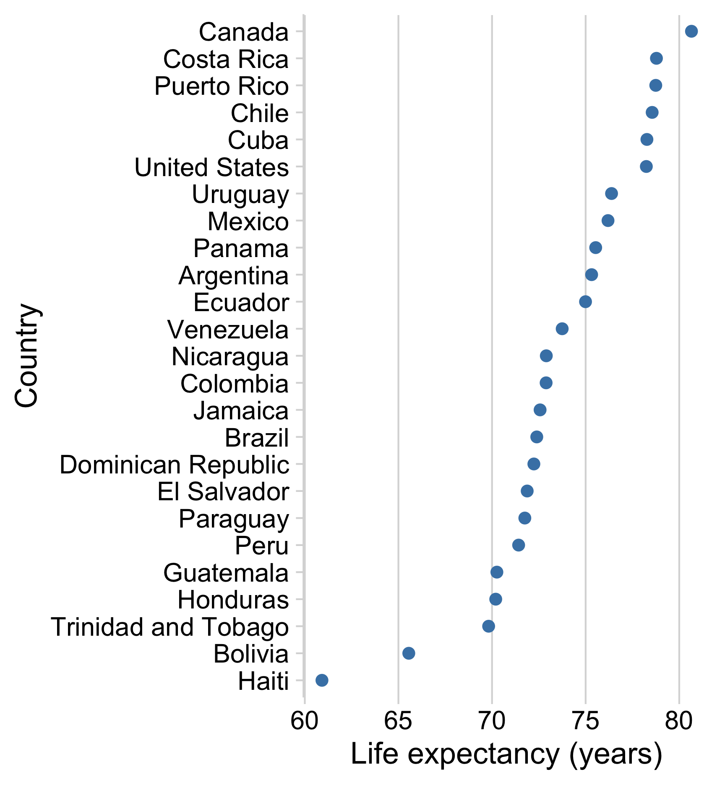{fig-align='center' width=576}
:::
:::

:::

::: {.col .fragment}

::: {.cell layout-align="center"}
::: {.cell-output-display}
{fig-align='center' width=576}
:::
:::

:::

---



## Or make zero the reference line


::: {.cell}

:::


::: {.col}

::: {.cell layout-align="center"}
::: {.cell-output-display}
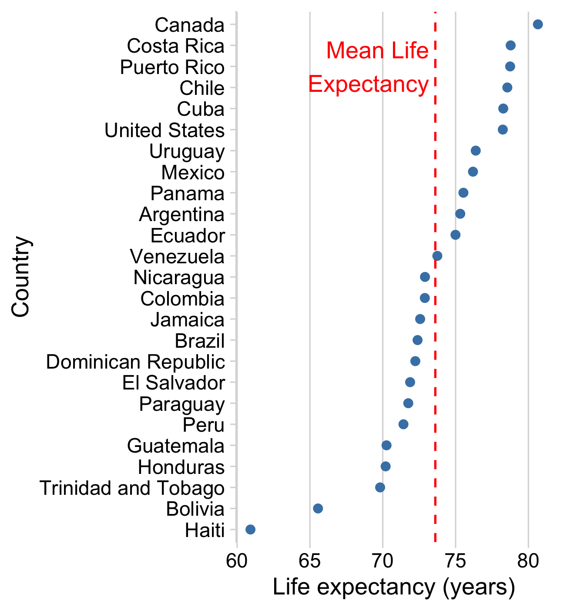{fig-align='center' width=576}
:::
:::

:::

::: {.col}

::: {.cell layout-align="center"}
::: {.cell-output-display}
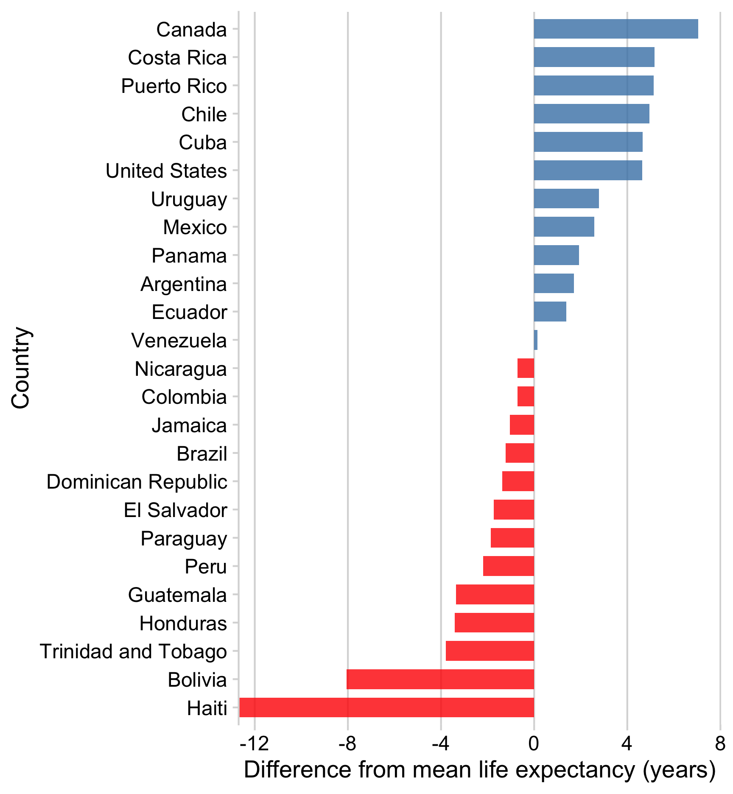{fig-align='center' width=576}
:::
:::

:::

---

## How to add a reference line

::: {.col width="60%"}
Add horizontal line with `geom_hline()`

Add vertical line with `geom_vline()`

::: {.font70}

::: {.cell}

```{.r .cell-code  code-line-numbers="7-11"}
ggplot(gapminder_americas) +
  geom_point(
    aes(x = lifeExp, y = country),
    color = 'steelblue',
    size = 2.5
  ) +
  geom_vline(
    xintercept = mean(gapminder_americas$lifeExp),
    color = 'red',
    linetype = 'dashed'
  ) +
  theme_minimal_vgrid() +
  labs(x = 'Life expectancy (years)', y = 'Country')
```
:::

:::
:::

::: {.col width="40%"}

::: {.cell layout-align="center"}
::: {.cell-output-display}
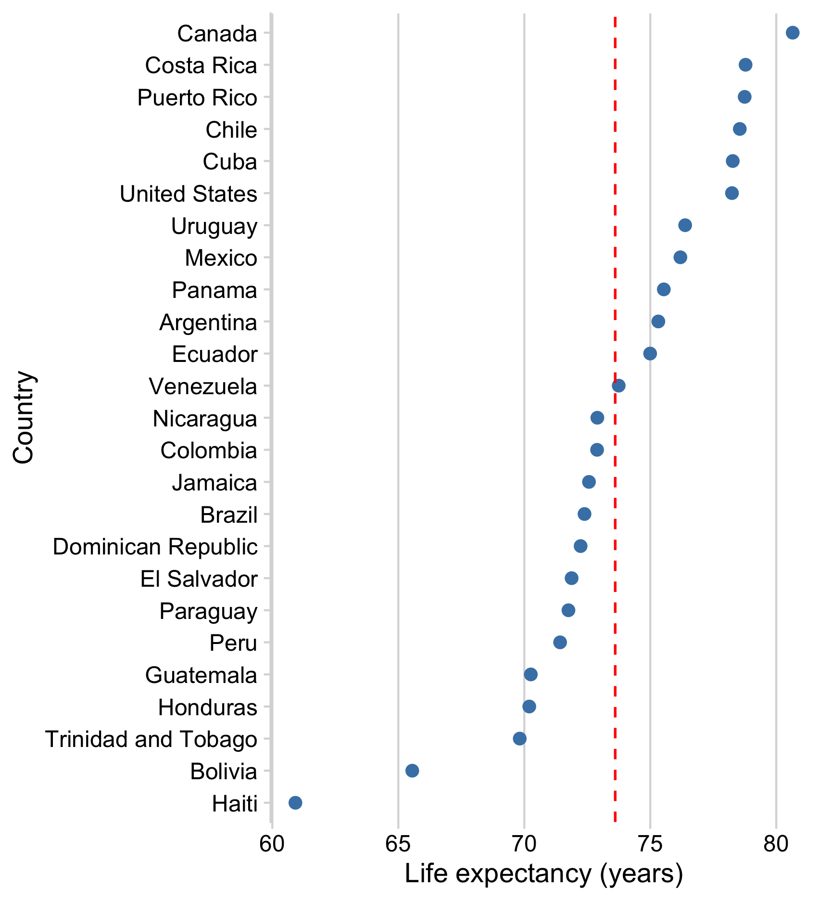{fig-align='center' width=576}
:::
:::

:::

---

## How to add a reference line

::: {.col width="60%"}
Add text with `annotate()`

::: {.font70}

::: {.cell}

```{.r .cell-code  code-line-numbers="13-19"}
ggplot(gapminder_americas) +
  geom_point(
    aes(x = lifeExp, y = country),
    color = 'steelblue',
    size = 2.5
  ) +
  geom_vline(
    xintercept = mean(gapminder_americas$lifeExp),
    color = 'red',
    linetype = 'dashed'
  ) +
  annotate(
    'text',
    x = 73.2,
    y = 'Puerto Rico',
    color = 'red',
    hjust = 1,
    label = 'Mean Life\nExpectancy'
  ) +
  theme_minimal_vgrid() +
  labs(x = 'Life expectancy (years)', y = 'Country')
```
:::

:::
:::

::: {.col width="40%" .center}

::: {.cell layout-align="center"}
::: {.cell-output-display}
{fig-align='center' width=576}
:::
:::

:::

---

## How to make zero the reference point

::: {.col width="60%"}
::: {.font70}

::: {.cell}

```{.r .cell-code  code-line-numbers="4,6"}
gapminder_diverging <- gapminder_americas %>%
    mutate(
        # Subtract the mean
        lifeExp = lifeExp - mean(lifeExp),
        # Define the fill color
        color = ifelse(lifeExp > 0, 'Above', 'Below')
    )
```
:::


::: {.cell}

```{.r .cell-code  code-line-numbers="3,8"}
ggplot(gapminder_diverging) +
  geom_col(
    aes(x = lifeExp, y = country, fill = color),
    width = 0.7,
    alpha = 0.8
  ) +
  scale_fill_manual(
    values = c('steelblue', 'red')
  ) +
  theme_minimal_vgrid() +
  theme(legend.position = 'none') +
  labs(
    x = 'Country',
    y = 'Difference from mean life expectancy (years)'
  )
```
:::

:::
:::

::: {.col width="40%"}

::: {.cell layout-align="center"}
::: {.cell-output-display}
{fig-align='center' width=576}
:::
:::

:::

---




::: {.cell}
::: {.cell-output-display}

```{=html}
<div class="countdown" id="timer_2c26ae17" data-warn-when="30" data-update-every="1" tabindex="0" style="top:0;right:0;font-size:2em;">
<div class="countdown-controls"><button class="countdown-bump-down">&minus;</button><button class="countdown-bump-up">&plus;</button></div>
<code class="countdown-time"><span class="countdown-digits minutes">15</span><span class="countdown-digits colon">:</span><span class="countdown-digits seconds">00</span></code>
</div>
```

:::
:::


### Your turn - comparing to a reference

Make a ranking chart and either a) add a reference line or b) show the ranking as the _difference_ from a reference (e.g. the mean). Use any dataset you want in the "data" folder (examples below using `milk_production.csv`)

::: {.col}

::: {.cell layout-align="center"}
::: {.cell-output-display}
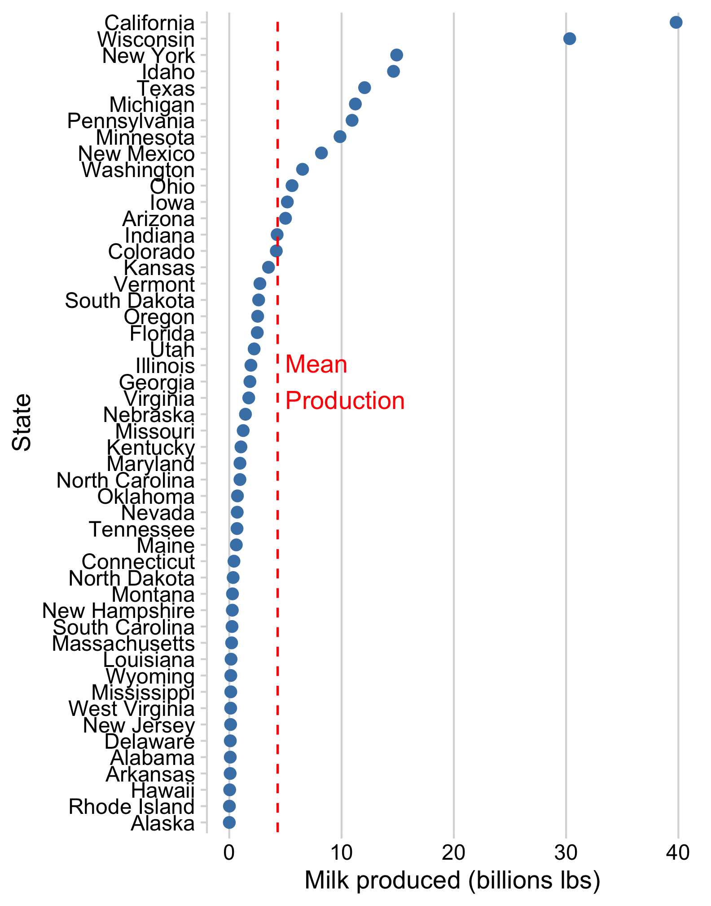{fig-align='center' width=60%}
:::
:::

:::

::: {.col}

::: {.cell layout-align="center"}
::: {.cell-output-display}
{fig-align='center' width=60%}
:::
:::

:::

---





# Week 9: [Comparisons]{.fancy}

<div style="height: 1.5em;"></div>

### 1. Comparing to a reference

### 2. [Comparing variables]{.orange}

### 3. Comparing distributions

<!--
Comparing categories with facets

Comparing two things (dodged bars, slope chart, dumbbell chart)

- dodged comparisons are fine, but really no more than 2 things.
- Finally, overlapping bars are great when you want to show when something exceeds a threshold. E.g. going over your budget.
- Using facets to break up 3-4 groups of 2 is okay.
- A better approach for multiple categories:
    - slope charts
    - dumbbell charts
-->

---




## Neither of these charts are great

::: {.col}

::: {.cell}
::: {.cell-output-display}
{width=696.192}
:::
:::

:::

::: {.col}

::: {.cell}
::: {.cell-output-display}
{width=696.192}
:::
:::

:::

---



## "Parallel Coordinates" plots work well

::: {.col .left}
::: {.font65}

::: {.cell}

```{.r .cell-code  code-line-numbers="4"}
diamonds %>%
  count(clarity, cut) %>%
  ggplot(
    aes(x = clarity, y = n, color = cut, group = cut)
  ) +
  geom_line() +
  geom_point() +
  scale_y_continuous(limits = c(0, 5100)) +
  theme_half_open(font_size = 18) +
  labs(y = "Count")
```
:::

:::
:::

::: {.col}

::: {.cell}
::: {.cell-output-display}
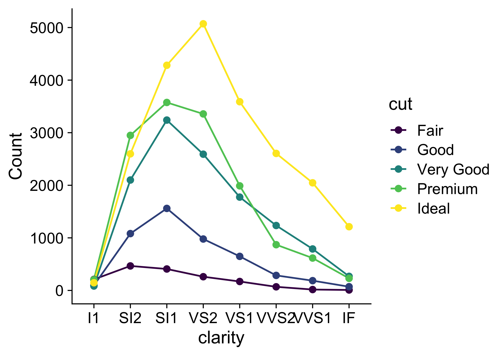{width=672}
:::
:::

:::

---

## Consider facets for **comparing across categories**

::: {.col width="60%"}
::: {.font75}

::: {.cell}

```{.r .cell-code  code-line-numbers="5"}
diamonds %>%
  count(clarity, cut) %>%
  ggplot() +
  geom_col(aes(x = clarity, y = n), width = 0.7) +
  facet_wrap(vars(cut), nrow = 1) +
  scale_y_continuous(
    expand = expansion(mult = c(0, 0.05))
  ) +
  theme_minimal_hgrid(font_size = 16)
```
:::

:::
:::

::: {.col width="40%"}
:::


::: {.cell}
::: {.cell-output-display}
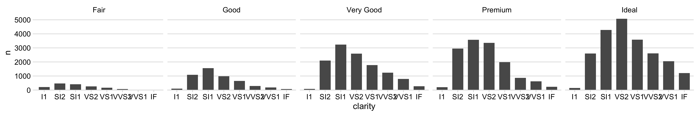{width=1728}
:::
:::


---

::: {.col}
## Consider facets for **comparing across categories**

::: {.font65}

::: {.cell}

```{.r .cell-code  code-line-numbers="6,7,11"}
diamonds %>%
  count(clarity, cut) %>%
  mutate(n = n / 1000) %>%
  ggplot() +
  geom_col(aes(x = clarity, y = n), width = 0.7) +
  facet_wrap(vars(cut), ncol = 2) +
  coord_flip() +
  scale_y_continuous(
    expand = expansion(mult = c(0, 0.05))
  ) +
  theme_minimal_vgrid(font_size = 16) +
  labs(y = "Count (thousands)")
```
:::

:::
:::

::: {.col}

::: {.cell layout-align="center"}
::: {.cell-output-display}
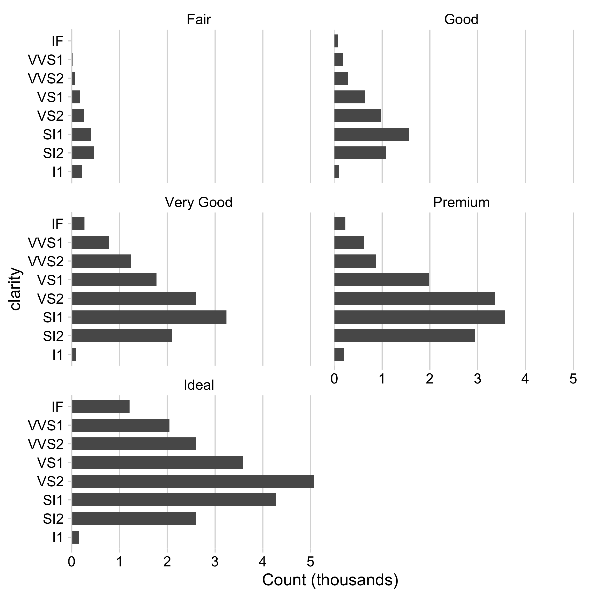{fig-align='center' width=768}
:::
:::

:::

---




<br><br><br><br><br><br><br><br><br><br><br><br><br><br><br><br><br>

::: {.right}
From [Financial Times](https://www.ft.com/coronavirus-latest)
:::

---




## When comparing across multiple categories, consider:

::: {.col}
## Parallel coordinates charts


::: {.cell}
::: {.cell-output-display}
{width=672}
:::
:::

:::

::: {.col}
## Faceting


::: {.cell layout-align="center"}
::: {.cell-output-display}
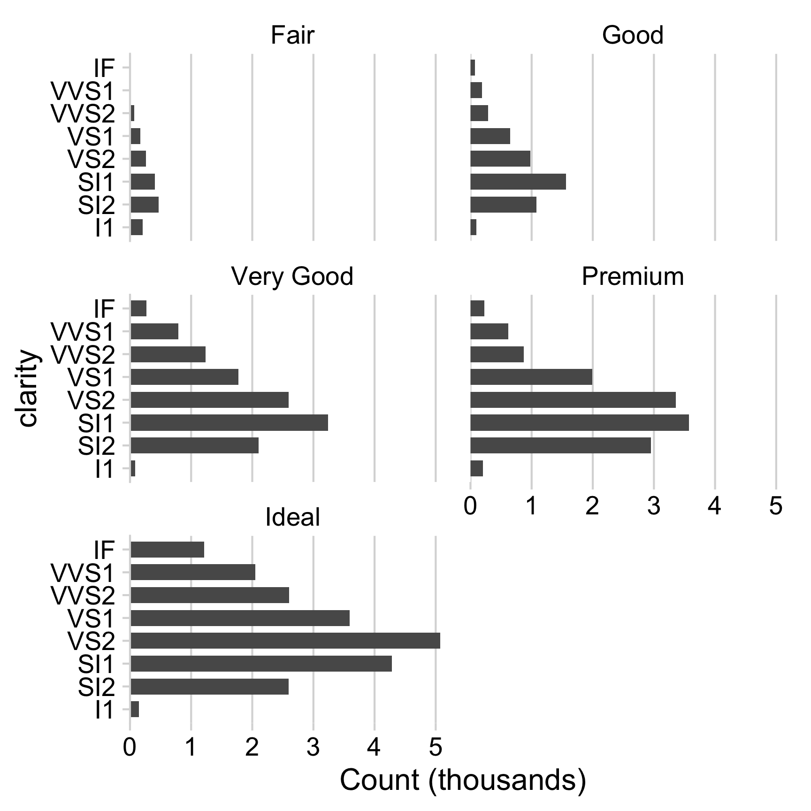{fig-align='center' width=70%}
:::
:::

:::

---

## [When comparing **only 2** things,<br>dodged bars are a good starting point]{.center}

::: {.col}
::: {.font65}

::: {.cell}

```{.r .cell-code}
milk_compare <- milk_production %>%
  filter(year %in% c(1970, 2017)) %>%
  mutate(
    state = fct_other(
      state,
      keep = c('California', 'Wisconsin')
    )
  ) %>%
  group_by(year, state) %>%
  summarise(
    milk_produced = sum(milk_produced) / 10^9
  )
```
:::


::: {.cell}
::: {.cell-output .cell-output-stdout}

```
#> # A tibble: 6 × 3
#> # Groups:   year [2]
#>    year state      milk_produced
#>   <dbl> <fct>              <dbl>
#> 1  1970 California          9.46
#> 2  1970 Wisconsin          18.4 
#> 3  1970 Other              89.1 
#> 4  2017 California         39.8 
#> 5  2017 Wisconsin          30.3 
#> 6  2017 Other             145.
```


:::
:::


::: {.cell}

:::

:::
:::

::: {.col}

::: {.cell layout-align="center"}
::: {.cell-output-display}
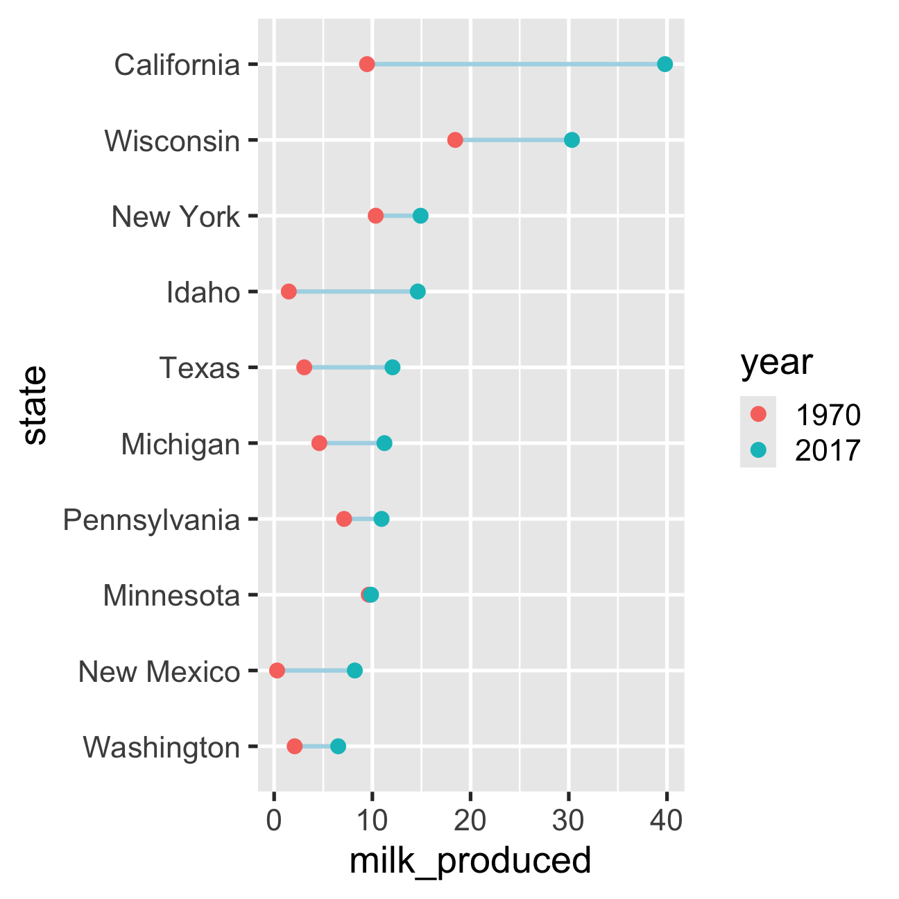{fig-align='center' width=672}
:::
:::

:::

---

## [When comparing **only 2** things,<br>dodged bars are a good starting point]{.center}

::: {.col}
::: {.font60}

::: {.cell}

```{.r .cell-code  code-line-numbers="10"}
ggplot(milk_compare) +
  geom_col(
    aes(
      x = milk_produced,
      y = state,
      fill = as.factor(year)
    ),
    width = 0.7,
    alpha = 0.8,
    position = 'dodge'
  ) +
  scale_fill_manual(
    values = c('grey', 'steelblue'),
    guide = guide_legend(reverse = TRUE)
  ) +
  scale_x_continuous(
    expand = expansion(mult = c(0, 0.05))
  ) +
  theme_minimal_vgrid() +
  labs(
    x = 'Milk produced (billion lbs)',
    y = NULL,
    fill = 'Year'
  )
```
:::

:::
:::

::: {.col}

::: {.cell layout-align="center"}
::: {.cell-output-display}
{fig-align='center' width=672}
:::
:::

:::

---



## Avoid putting >2 categories in legend (if possible)

::: {.col}
{width="100"}


::: {.cell layout-align="center"}
::: {.cell-output-display}
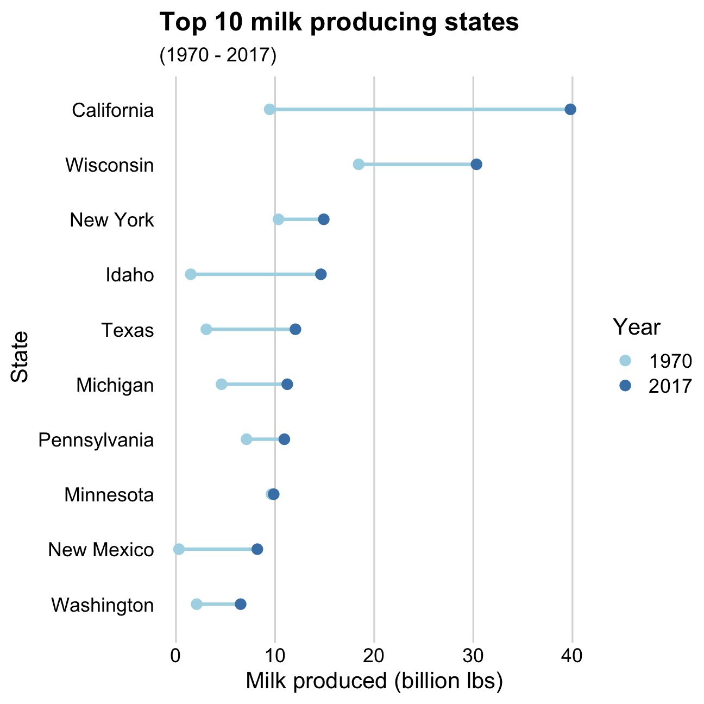{fig-align='center' width=672}
:::
:::

:::

::: {.col}
{width="130"}


::: {.cell layout-align="center"}
::: {.cell-output-display}
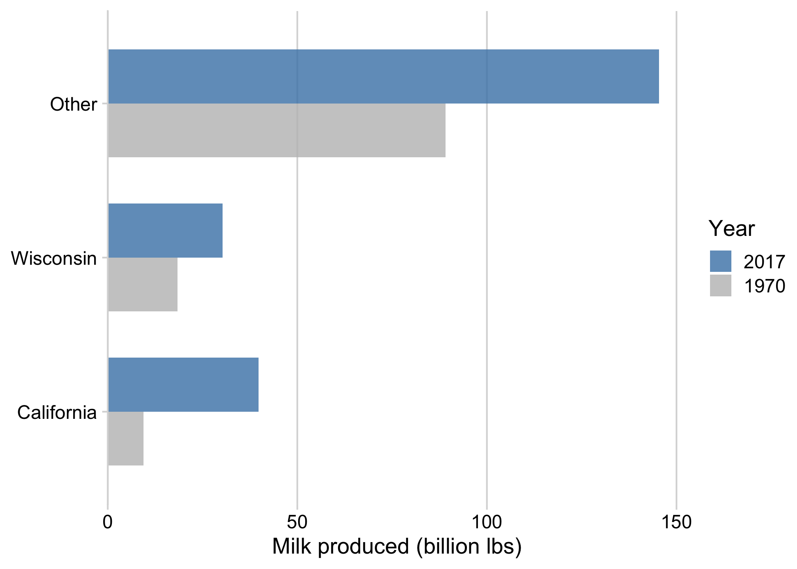{fig-align='center' width=672}
:::
:::

:::

---

## [Or use facets to get rid of the legend!]{.center}

::: {.col}
::: {.center}
{width="100"}
:::


::: {.cell layout-align="center"}
::: {.cell-output-display}
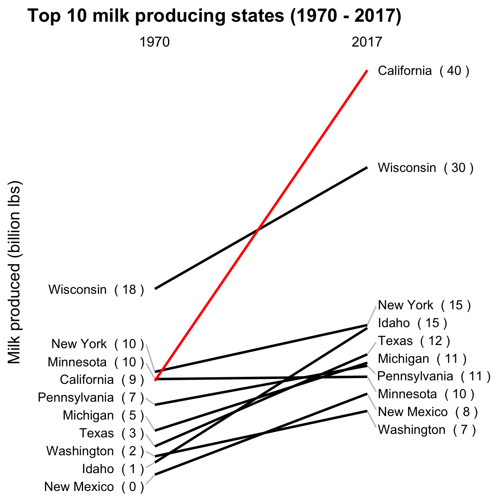{fig-align='center' width=672}
:::
:::

:::

::: {.col}
::: {.center}
{width="130"}
:::


::: {.cell layout-align="center"}
::: {.cell-output-display}
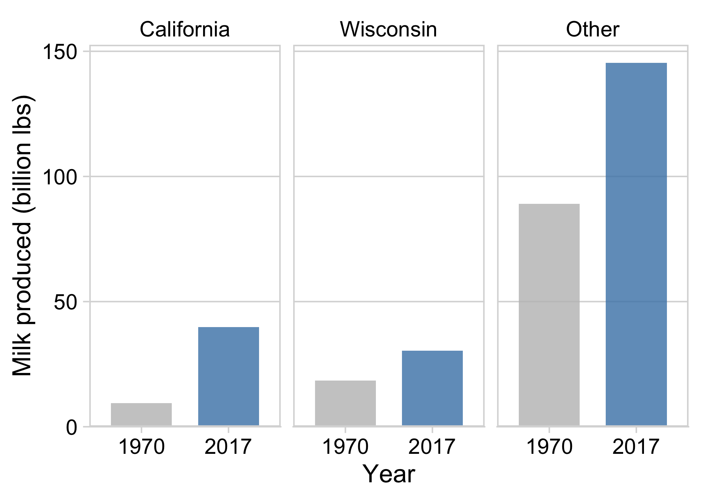{fig-align='center' width=672}
:::
:::

:::

---



## "Bullet" charts are also effective for comparing **2** things


::: {.cell layout-align="center"}
::: {.cell-output-display}
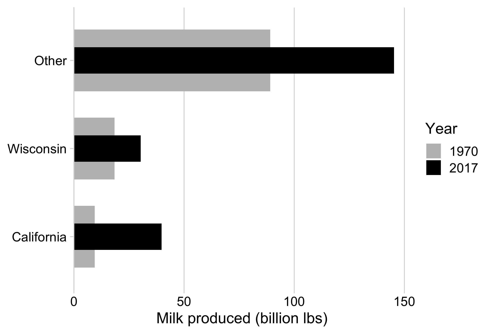{fig-align='center' width=768}
:::
:::


---

## How to make a "bullet" chart

::: {.col}
::: {.font65}

::: {.cell}

```{.r .cell-code  code-line-numbers="2-5,9,13"}
milk_compare %>%
  pivot_wider(
    names_from = year,
    values_from = milk_produced
  ) %>%
  ggplot() +
  geom_col(
    aes(x = `1970`, y = state, fill = '1970'),
    width = 0.7
  ) +
  geom_col(
    aes(x = `2017`, y = state, fill = '2017'),
    width = 0.3
  ) +
  scale_fill_manual(
    values = c('grey', 'black')
  ) +
  scale_x_continuous(
    expand = expansion(mult = c(0, 0.05))
  ) +
  theme_minimal_vgrid(font_size = 18) +
  labs(
    x = 'Milk produced (billion lbs)',
    y = NULL,
    fill = "Year"
  )
```
:::

:::
:::

::: {.col .center}

::: {.cell layout-align="center"}
::: {.cell-output-display}
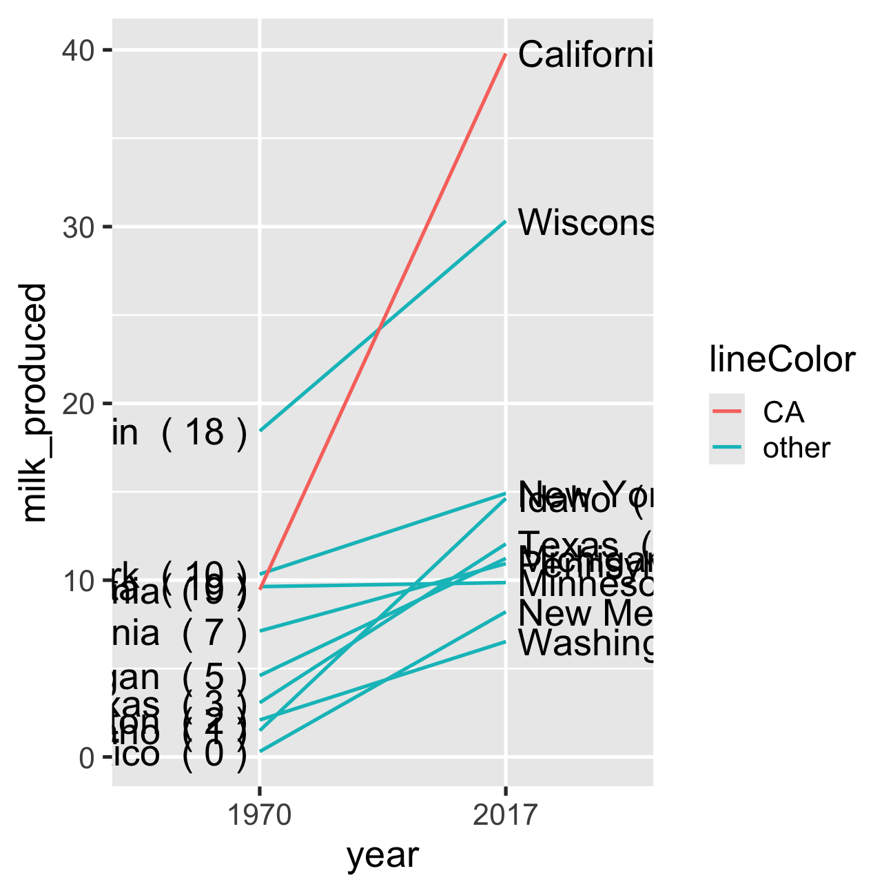{fig-align='center' width=768}
:::
:::

:::

---



## With **more than 2** things, dodged bars can get confusing

Still comparing 2 time periods, but across **10** categories


::: {.cell}

:::


::: {.cell layout-align="center"}
::: {.cell-output-display}
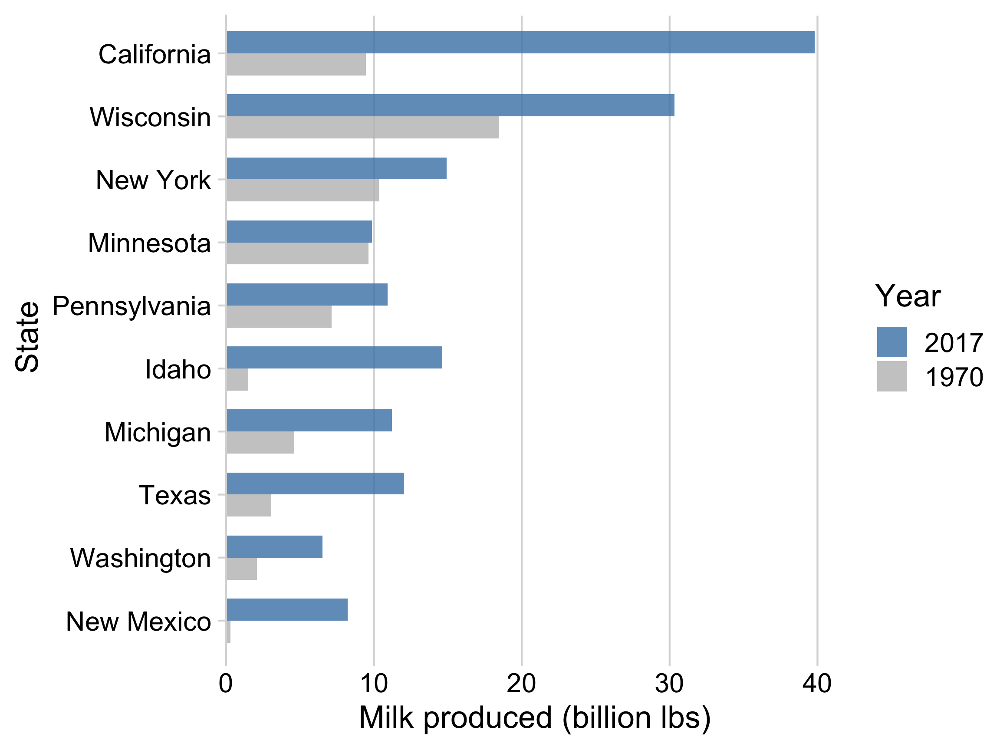{fig-align='center' width=768}
:::
:::


---



### Strategies for comparing 2 things across **more than 2 categories**

::: {.col}
**Dodged bars** 😢


::: {.cell layout-align="center"}
::: {.cell-output-display}
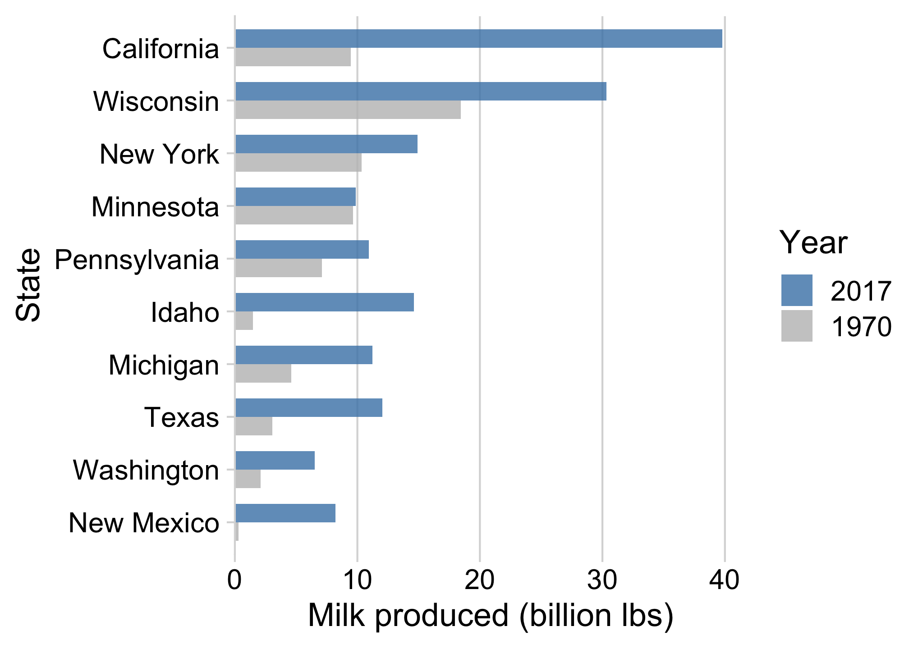{fig-align='center' width=672}
:::
:::

:::

::: {.col .fragment}
**Dumbbell bars** 😄


::: {.cell}

:::


::: {.cell layout-align="center"}
::: {.cell-output-display}
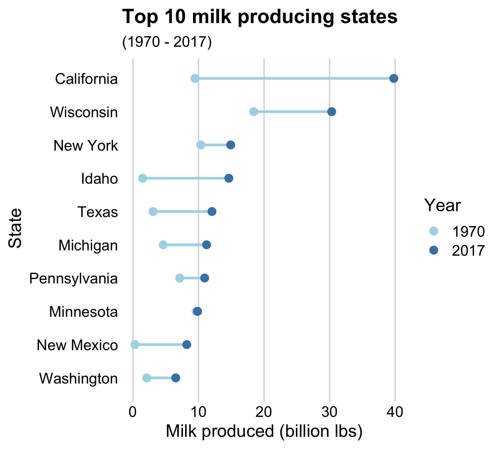{fig-align='center' width=528}
:::
:::

:::

---



### Strategies for comparing 2 things across **more than 2 categories**

::: {.col}
**Dodged bars** 😢


::: {.cell layout-align="center"}
::: {.cell-output-display}
{fig-align='center' width=672}
:::
:::

:::

::: {.col .fragment}
**Slope chart** 😄


::: {.cell}

:::


::: {.cell layout-align="center"}
::: {.cell-output-display}
{fig-align='center' width=576}
:::
:::

:::

---

::: {.col}
Dumbbell charts highlight:

- Compare **magnitudes** across two periods / groups


::: {.cell layout-align="center"}
::: {.cell-output-display}
{fig-align='center' width=576}
:::
:::

:::

::: {.col .fragment}
Slope charts highlight:

- _Change_ in **rankings**
- Highlight individual categories


::: {.cell layout-align="center"}
::: {.cell-output-display}
{fig-align='center' width=576}
:::
:::

:::

---

## How to make a **Dumbbell chart**

::: {.col}
Create data frame for plotting

::: {.font70}

::: {.cell}

```{.r .cell-code}
top10states <- milk_production %>%
  filter(year == 2017) %>%
  arrange(desc(milk_produced)) %>%
  slice(1:10)

milk_summary_dumbbell <- milk_production %>%
  filter(
    year %in% c(1970, 2017),
    state %in% top10states$state
  ) %>%
  mutate(
    # Reorder state variables
    state = fct_reorder2(
      state,
      year,
      desc(milk_produced)
    ),
    # Convert year to discrete variable
    year = as.factor(year),
    # Modify units
    milk_produced = milk_produced / 10^9
  )
```
:::

:::
:::

::: {.col}

::: {.cell layout-align="center"}
::: {.cell-output-display}
{fig-align='center' width=576}
:::
:::

:::

---

## How to make a **Dumbbell chart**

::: {.col}
Make lines (note the `group` variable)

::: {.font70}

::: {.cell}

```{.r .cell-code  code-line-numbers="3,5,6"}
ggplot(
     milk_summary_dumbbell,
     aes(x = milk_produced, y = state)
) +
     geom_line(
          aes(group = state),
          color = 'lightblue',
          size = 1
     )
```
:::

:::
:::

::: {.col}

::: {.cell layout-align="center"}
::: {.cell-output-display}
{fig-align='center' width=576}
:::
:::

:::

---

## How to make a **Dumbbell chart**

::: {.col}
Add points (note the `color` variable)

::: {.font70}

::: {.cell}

```{.r .cell-code  code-line-numbers="10"}
ggplot(
     milk_summary_dumbbell,
     aes(x = milk_produced, y = state)
) +
     geom_line(
          aes(group = state),
          color = 'lightblue',
          size = 1
     ) +
     geom_point(aes(color = year), size = 2.5)
```
:::

:::
:::

::: {.col}

::: {.cell layout-align="center"}
::: {.cell-output-display}
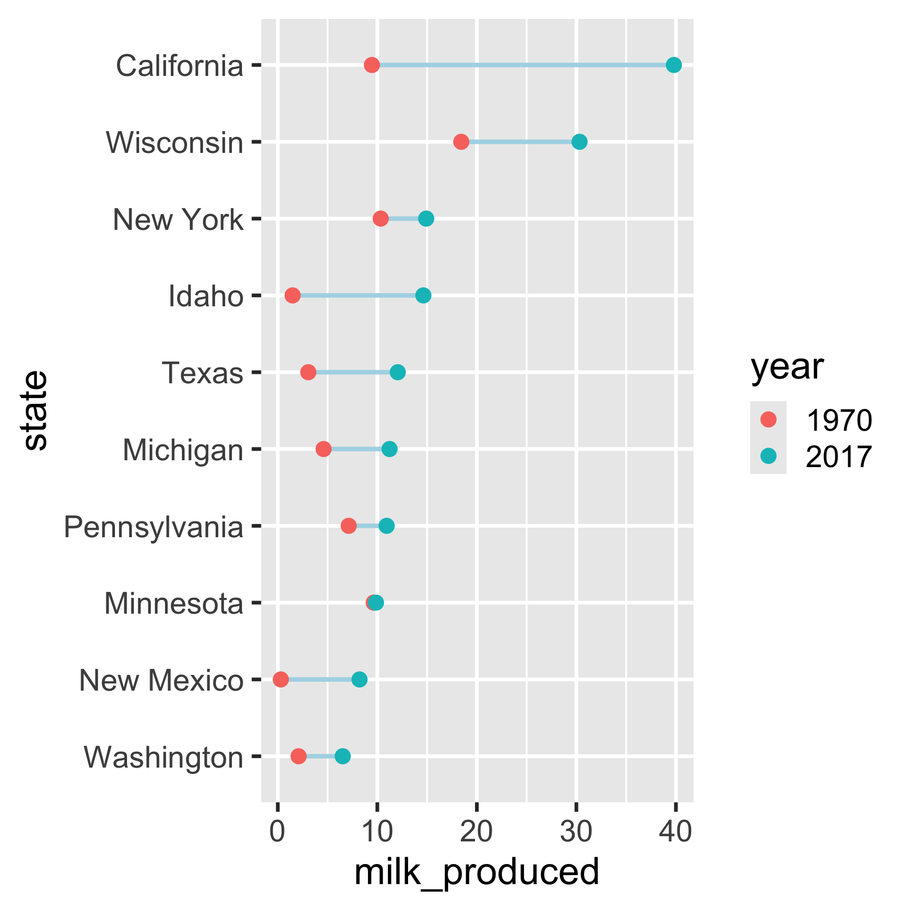{fig-align='center' width=576}
:::
:::

:::

---

## How to make a **Dumbbell chart**

::: {.col}
Change the colors:

::: {.font70}

::: {.cell}

```{.r .cell-code  code-line-numbers="11-13"}
ggplot(
    milk_summary_dumbbell,
    aes(x = milk_produced, y = state)
) +
    geom_line(
        aes(group = state),
        color = 'lightblue',
        size = 1
    ) +
    geom_point(aes(color = year), size = 2.5) +
    scale_color_manual(
        values = c('lightblue', 'steelblue')
    )
```
:::

:::
:::

::: {.col}

::: {.cell layout-align="center"}
::: {.cell-output-display}
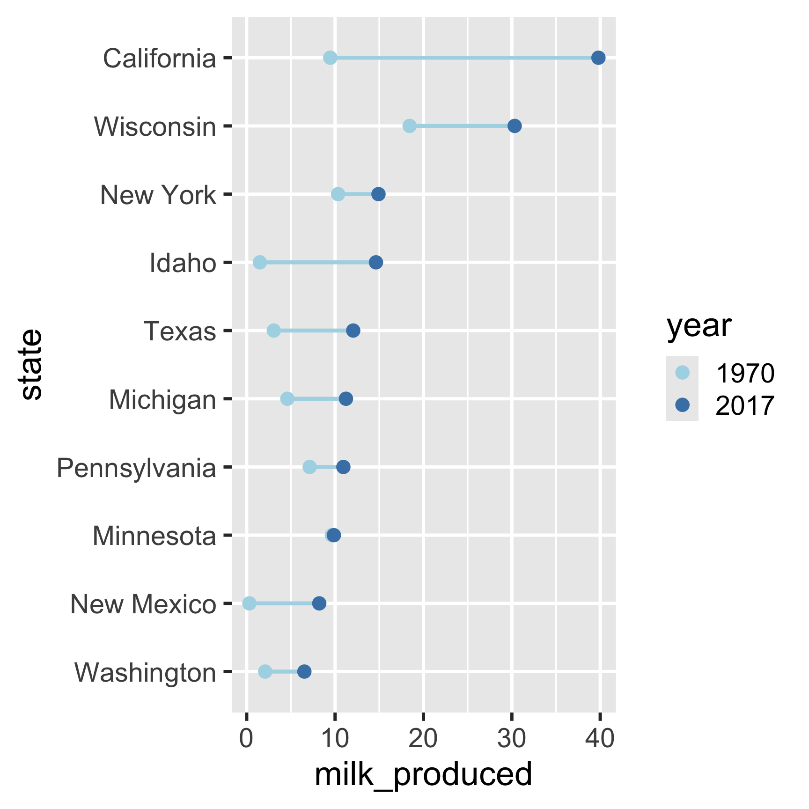{fig-align='center' width=576}
:::
:::

:::

---

## How to make a **Dumbbell chart**

::: {.col}
Adjust the theme and annotate

::: {.font60}

::: {.cell}

```{.r .cell-code  code-line-numbers="14,16-26"}
ggplot(
  milk_summary_dumbbell,
  aes(x = milk_produced, y = state)
) +
  geom_line(
    aes(group = state),
    color = 'lightblue',
    size = 1
  ) +
  geom_point(aes(color = year), size = 2.5) +
  scale_color_manual(
    values = c('lightblue', 'steelblue')
  ) +
  theme_minimal_vgrid() +
  # Remove y axis line and tick marks
  theme(
    axis.line.y = element_blank(),
    axis.ticks.y = element_blank()
  ) +
  labs(
    x = 'Milk produced (billion lbs)',
    y = 'State',
    color = 'Year',
    title = 'Top 10 milk producing states',
    subtitle = '(1970 - 2017)'
  )
```
:::

:::
:::

::: {.col}

::: {.cell layout-align="center"}
::: {.cell-output-display}
{fig-align='center' width=576}
:::
:::

:::

---

::: {.col}
Create data frame for plotting

::: {.font55}

::: {.cell}

```{.r .cell-code  code-line-numbers="18-27"}
top10states <- milk_production %>%
  filter(year == 2017) %>%
  arrange(desc(milk_produced)) %>%
  slice(1:10)

milk_summary_slope <- milk_production %>%
  filter(
    year %in% c(1970, 2017),
    state %in% top10states$state
  ) %>%
  mutate(
    # Reorder state variables
    state = fct_reorder2(state, year, desc(milk_produced)),
    # Convert year to discrete variable
    year = as.factor(year),
    # Modify units
    milk_produced = milk_produced / 10^9,
    # Define line color
    lineColor = if_else(
      state == 'California',
      'CA',
      'other'
    ),
    # Make labels
    label = paste(state, ' (', round(milk_produced), ')'),
    label_left = ifelse(year == 1970, label, NA),
    label_right = ifelse(year == 2017, label, NA)
  )
```
:::

:::
:::

::: {.col}
## [How to make a<br>**Slope chart**]{.center}

::: {.font50}

::: {.cell layout-align="center"}
::: {.cell-output-display}
{fig-align='center' width=576}
:::
:::

:::
:::

---

::: {.col}
Create data frame for plotting

::: {.font55}

::: {.cell}

```{.r .cell-code  code-line-numbers="18-27"}
top10states <- milk_production %>%
  filter(year == 2017) %>%
  arrange(desc(milk_produced)) %>%
  slice(1:10)

milk_summary_slope <- milk_production %>%
  filter(
    year %in% c(1970, 2017),
    state %in% top10states$state
  ) %>%
  mutate(
    # Reorder state variables
    state = fct_reorder2(state, year, desc(milk_produced)),
    # Convert year to discrete variable
    year = as.factor(year),
    # Modify units
    milk_produced = milk_produced / 10^9,
    # Define line color
    lineColor = if_else(
      state == 'California',
      'CA',
      'other'
    ),
    # Make labels
    label = paste(state, ' (', round(milk_produced), ')'),
    label_left = ifelse(year == 1970, label, NA),
    label_right = ifelse(year == 2017, label, NA)
  )
```
:::

:::
:::

::: {.col}
## [How to make a<br>**Slope chart**]{.center}

::: {.font50}

::: {.cell}

```{.r .cell-code}
milk_summary_slope %>%
    select(state, year, milk_produced, label, lineColor)
```

::: {.cell-output .cell-output-stdout}

```
#> # A tibble: 20 × 5
#>    state        year  milk_produced label                lineColor
#>    <fct>        <fct>         <dbl> <chr>                <chr>    
#>  1 New York     1970         10.3   New York  ( 10 )     other    
#>  2 Pennsylvania 1970          7.12  Pennsylvania  ( 7 )  other    
#>  3 Michigan     1970          4.60  Michigan  ( 5 )      other    
#>  4 Wisconsin    1970         18.4   Wisconsin  ( 18 )    other    
#>  5 Minnesota    1970          9.64  Minnesota  ( 10 )    other    
#>  6 Texas        1970          3.06  Texas  ( 3 )         other    
#>  7 Idaho        1970          1.49  Idaho  ( 1 )         other    
#>  8 New Mexico   1970          0.304 New Mexico  ( 0 )    other    
#>  9 Washington   1970          2.09  Washington  ( 2 )    other    
#> 10 California   1970          9.46  California  ( 9 )    CA       
#> 11 New York     2017         14.9   New York  ( 15 )     other    
#> 12 Pennsylvania 2017         10.9   Pennsylvania  ( 11 ) other    
#> 13 Michigan     2017         11.2   Michigan  ( 11 )     other    
#> 14 Wisconsin    2017         30.3   Wisconsin  ( 30 )    other    
#> 15 Minnesota    2017          9.86  Minnesota  ( 10 )    other    
#> 16 Texas        2017         12.1   Texas  ( 12 )        other    
#> 17 Idaho        2017         14.6   Idaho  ( 15 )        other    
#> 18 New Mexico   2017          8.21  New Mexico  ( 8 )    other    
#> 19 Washington   2017          6.53  Washington  ( 7 )    other    
#> 20 California   2017         39.8   California  ( 40 )   CA
```


:::
:::

:::
:::

---

## How to make a **Slope chart**

::: {.col}
Start with a line plot - note the `group` variable:

::: {.font65}

::: {.cell}

```{.r .cell-code  code-line-numbers="3,5"}
ggplot(
       milk_summary_slope,
       aes(x = year, y = milk_produced, group = state)
) +
       geom_line(aes(color = lineColor))
```
:::

:::
:::

::: {.col}

::: {.cell layout-align="center"}
::: {.cell-output-display}
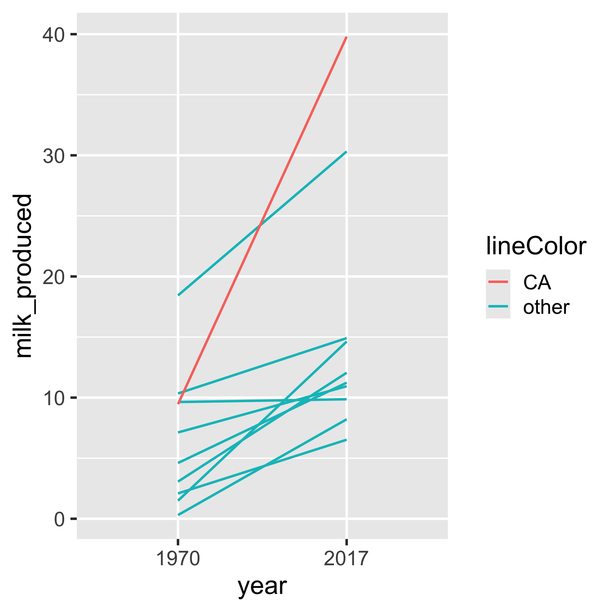{fig-align='center' width=576}
:::
:::

:::

---

## How to make a **Slope chart**

::: {.col}
Add labels:

::: {.font60}

::: {.cell}

```{.r .cell-code  code-line-numbers="7-11,13-17"}
ggplot(
       milk_summary_slope,
       aes(x = year, y = milk_produced, group = state)
) +
       geom_line(aes(color = lineColor)) +
       # Add 1970 labels (left side)
       geom_text(
              aes(label = label_left),
              hjust = 1,
              nudge_x = -0.05
       ) +
       # Add 2017 labels (right side)
       geom_text(
              aes(label = label_right),
              hjust = 0,
              nudge_x = 0.05
       )
```
:::


Justification | `hjust`
--------------|-------
Left          | 0
Center        | 0.5
Right         | 1
:::
:::

::: {.col}

::: {.cell layout-align="center"}
::: {.cell-output-display}
{fig-align='center' width=576}
:::
:::

:::

---




## Overlapping labels?

::: {.col width="30%" .border}
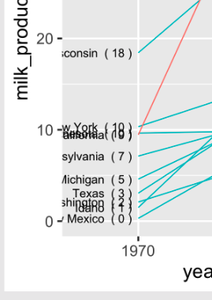{width="360" .nostretch}
:::

::: {.col width="70%"}
:::

---




## Overlapping labels?<br>**ggrepel** library to the rescue!

::: {.col width="30%" .border}
{width="360" .nostretch}
:::

::: {.col width="70%"}
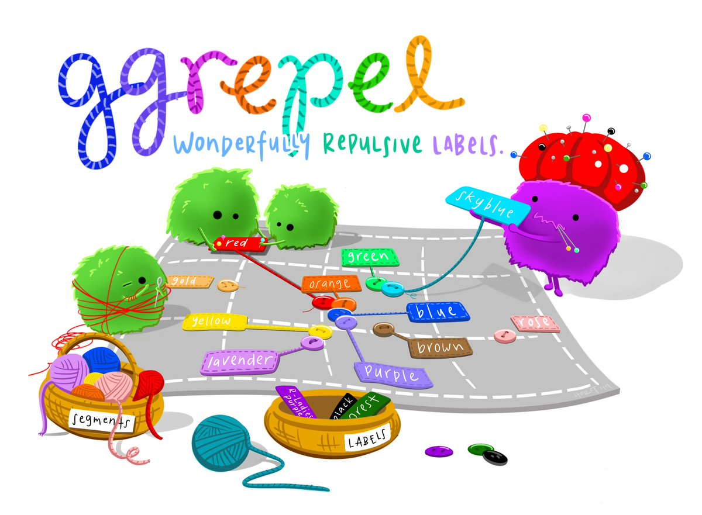{width="790"}
:::

[Artwork by [@allison_horst](https://twitter.com/allison_horst)]{.left}

---

## How to make a **Slope chart**

::: {.col}
Align labels so they don't overlap:

::: {.font65}

::: {.cell}

```{.r .cell-code  code-line-numbers="1,9,13,14,17,21,22"}
library(ggrepel)

ggplot(
  milk_summary_slope,
  aes(x = year, y = milk_produced, group = state)
) +
  geom_line(aes(color = lineColor)) +
  # Add 1970 labels (left side)
  geom_text_repel(
    aes(label = label_left),
    hjust = 1,
    nudge_x = -0.05,
    direction = 'y',
    segment.color = 'grey'
  ) +
  # Add 2017 labels (right side)
  geom_text_repel(
    aes(label = label_right),
    hjust = 0,
    nudge_x = 0.05,
    direction = 'y',
    segment.color = 'grey'
  )
```
:::

:::
:::

::: {.col}

::: {.cell layout-align="center"}
::: {.cell-output-display}
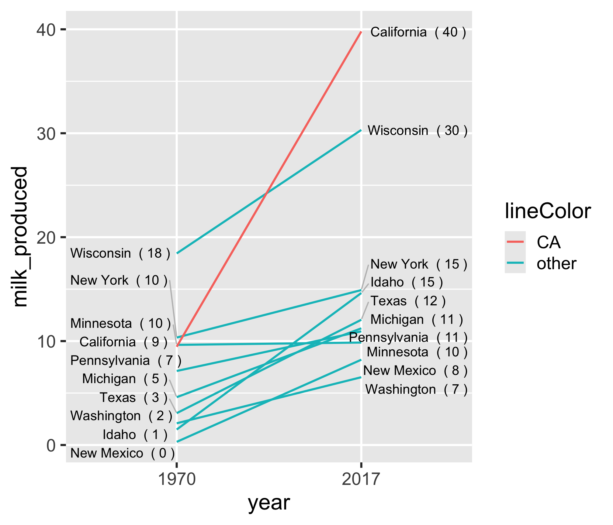{fig-align='center' width=672}
:::
:::

:::

---

## How to make a **Slope chart**

::: {.col}
Adjust colors:

::: {.font65}

::: {.cell}

```{.r .cell-code  code-line-numbers="21,22"}
ggplot(
  milk_summary_slope,
  aes(x = year, y = milk_produced, group = state)
) +
  geom_line(aes(color = lineColor)) +
  geom_text_repel(
    aes(label = label_left),
    hjust = 1,
    nudge_x = -0.05,
    direction = 'y',
    segment.color = 'grey'
  ) +
  geom_text_repel(
    aes(label = label_right),
    hjust = 0,
    nudge_x = 0.05,
    direction = 'y',
    segment.color = 'grey'
  ) +
  # Move year labels to top, modify line colors
  scale_x_discrete(position = 'top') +
  scale_color_manual(values = c('red', 'black'))
```
:::

:::
:::

::: {.col}

::: {.cell layout-align="center"}
::: {.cell-output-display}
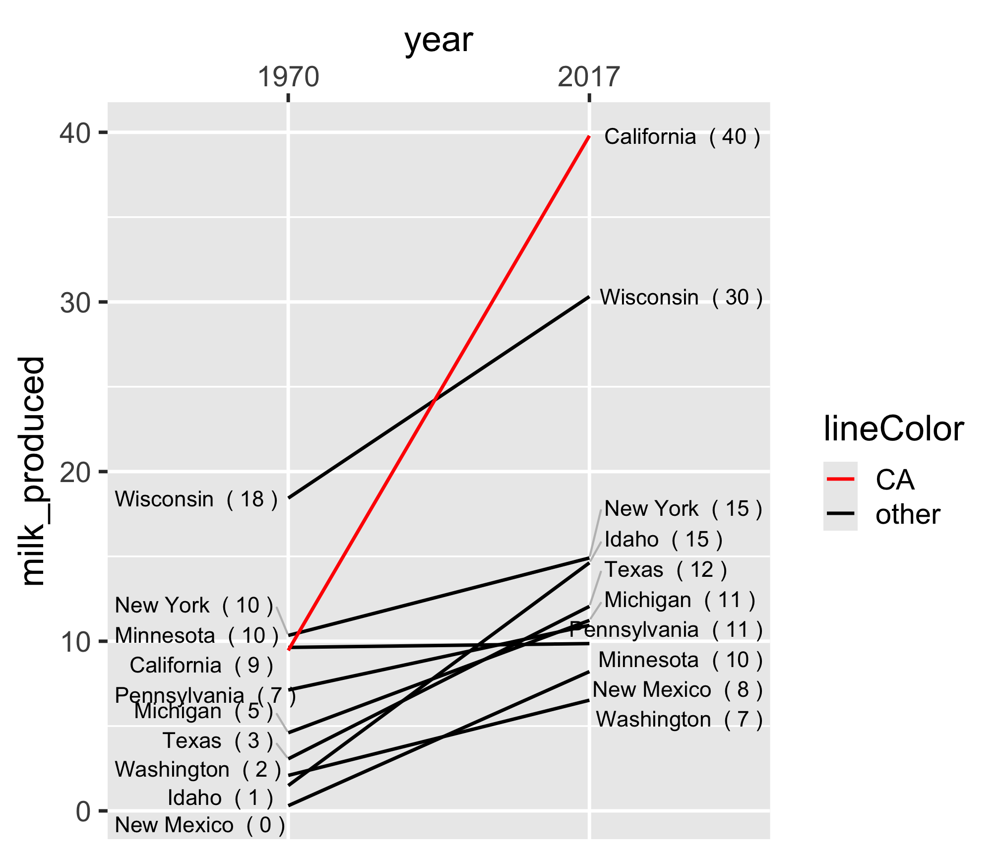{fig-align='center' width=672}
:::
:::

:::

---

::: {.col}
Adjust the theme and annotate

::: {.font50}

::: {.cell}

```{.r .cell-code  code-line-numbers="31-37"}
ggplot(
  milk_summary_slope,
  aes(x = year, y = milk_produced, group = state)
) +
  geom_line(aes(color = lineColor)) +
  # Add 1970 labels (left side)
  geom_text_repel(
    aes(label = label_left),
    hjust = 1,
    nudge_x = -0.05,
    direction = 'y',
    segment.color = 'grey'
  ) +
  # Add 2017 labels (right side)
  geom_text_repel(
    aes(label = label_right),
    hjust = 0,
    nudge_x = 0.05,
    direction = 'y',
    segment.color = 'grey'
  ) +
  # Move year labels to top, modify line colors
  scale_x_discrete(position = 'top') +
  scale_color_manual(values = c('red', 'black')) +
  # Annotate & adjust theme
  labs(
    x = NULL,
    y = 'Milk produced (billion lbs)',
    title = 'Top 10 milk producing states (1970 - 2017)'
  ) +
  theme_minimal_grid() +
  theme(
    panel.grid = element_blank(),
    axis.text.y = element_blank(),
    axis.ticks = element_blank(),
    legend.position = 'none'
  )
```
:::

:::
:::

::: {.col}
## [How to make a<br>**Slope chart**]{.center}


::: {.cell layout-align="center"}
::: {.cell-output-display}
{fig-align='center' width=576}
:::
:::

:::

---




::: {.cell}
::: {.cell-output-display}

```{=html}
<div class="countdown" id="timer_8c203617" data-warn-when="30" data-update-every="1" tabindex="0" style="top:0;right:0;font-size:2em;">
<div class="countdown-controls"><button class="countdown-bump-down">&minus;</button><button class="countdown-bump-up">&plus;</button></div>
<code class="countdown-time"><span class="countdown-digits minutes">20</span><span class="countdown-digits colon">:</span><span class="countdown-digits seconds">00</span></code>
</div>
```

:::
:::


## Your turn - comparing multiple categories

Using the `internet_regions` data frame, pick a strategy and create an improved version of this chart.

::: {.col width="30%"}
Strategies:

- Dodged bars
- Facets
- Bullet chart
- Dumbell chart
- Slope chart
:::

::: {.col width="70%"}

::: {.cell}
::: {.cell-output-display}
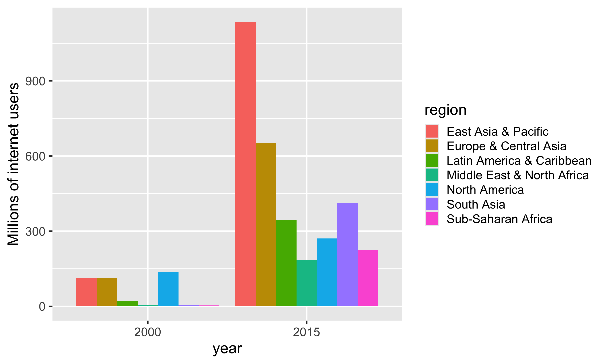{width=80%}
:::
:::

:::

---





::: {.cell}
::: {.cell-output-display}

```{=html}
<div class="countdown" id="timer_ab8f89f5" data-warn-when="30" data-update-every="1" tabindex="0" style="top:1;right:0;bottom:0;left:0;margin:5%;font-size:8em;">
<div class="countdown-controls"><button class="countdown-bump-down">&minus;</button><button class="countdown-bump-up">&plus;</button></div>
<code class="countdown-time"><span class="countdown-digits minutes">05</span><span class="countdown-digits colon">:</span><span class="countdown-digits seconds">00</span></code>
</div>
```

:::
:::


# Break!

## Stand up, Move around, Stretch!

---





# Week 9: [Comparisons]{.fancy}

<div style="height: 1.5em;"></div>

### 1. Comparing to a reference

### 2. Comparing variables

### 3. [Comparing distributions]{.orange}

<!-- Comparing distributions

- Box plots
- Transparent histograms & densities (good for maybe 2 categories)
- Ridgeline plots (good for lots of categories)

Ridgeline plots: https://wilkelab.org/ggridges/ -->

<!-- Helpful:
https://datavizf17.classes.andrewheiss.com/files/example_2017-09-19.Rmd -->

---



## Overlapping histograms have issues

::: {.col}
### Bad


::: {.cell layout-align="center"}
::: {.cell-output-display}
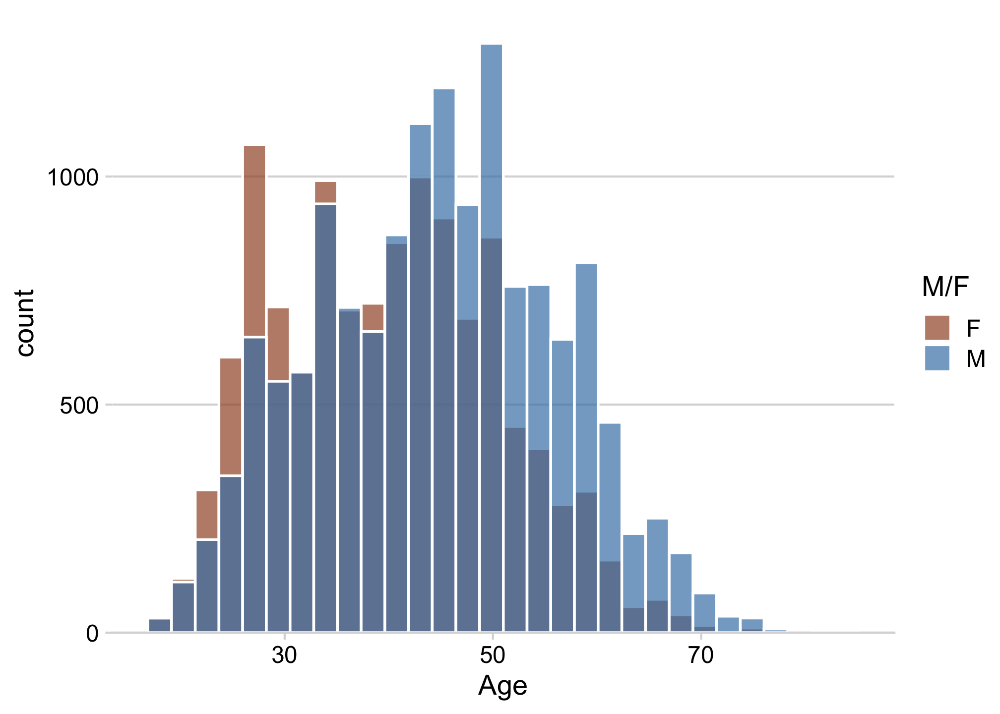{fig-align='center' width=672}
:::
:::

:::

::: {.col .fragment}
### Slightly better


::: {.cell layout-align="center"}
::: {.cell-output-display}
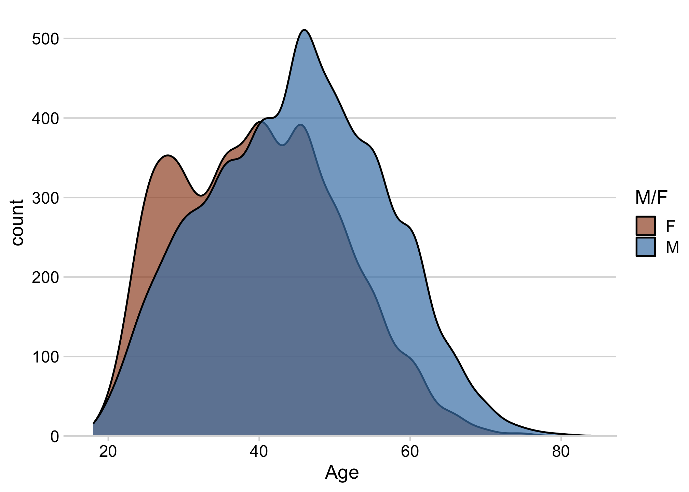{fig-align='center' width=672}
:::
:::

:::

---



## Good when number of categories is **small**

::: {.col}
### Density facets


::: {.cell layout-align="center"}
::: {.cell-output-display}
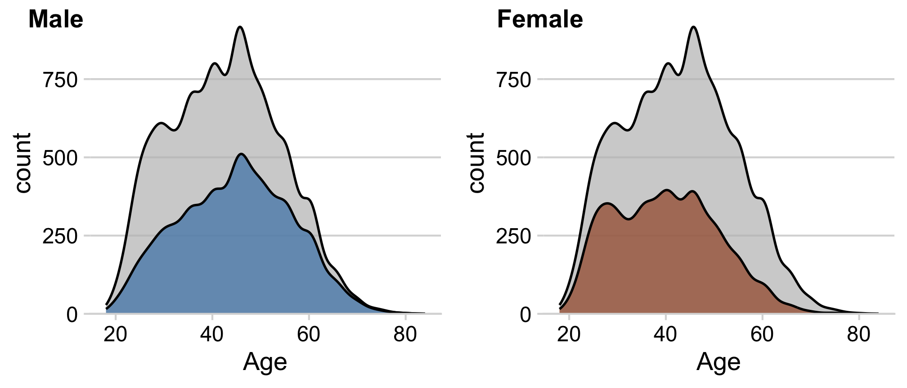{fig-align='center' width=672}
:::
:::

:::

::: {.col .fragment}
### Diverging histograms


::: {.cell layout-align="center"}
::: {.cell-output-display}
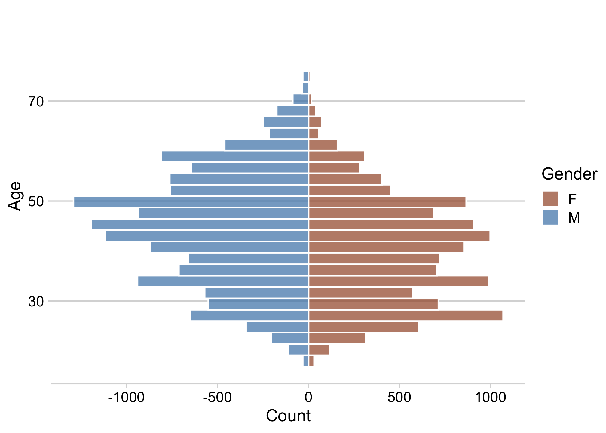{fig-align='center' width=672}
:::
:::

:::

---



## Good when number of categories is **large**

::: {.col}
### Boxplot


::: {.cell layout-align="center"}
::: {.cell-output-display}
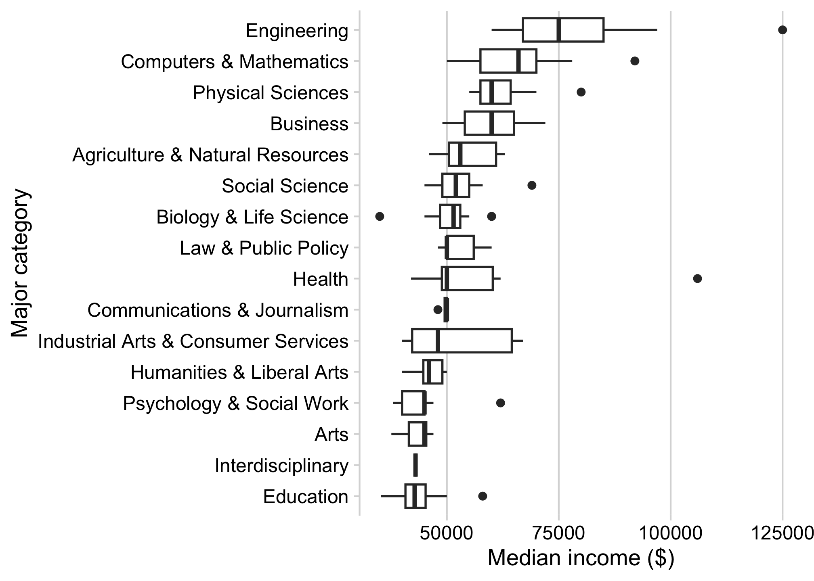{fig-align='center' width=672}
:::
:::

:::

::: {.col .fragment}
### Ridgeplot


::: {.cell layout-align="center"}
::: {.cell-output-display}
{fig-align='center' width=672}
:::
:::

:::

---

::: {.col}
## How to make density facets

You can use `facet_wrap()`, but<br>you won't get the full density overlay

::: {.font70}

::: {.cell}

```{.r .cell-code  code-line-numbers="5,6"}
ggplot(
    marathon,
    aes(x = Age, y = ..count.., fill = `M/F`)
) +
    geom_density(alpha = 0.7) +
    facet_wrap(vars(`M/F`)) +
    scale_fill_manual(
        values = c('sienna', 'steelblue')
    ) +
    scale_y_continuous(
        expand = expansion(mult = c(0, 0.05))
    ) +
    theme_minimal_hgrid()
```
:::

:::
:::

::: {.col}

::: {.cell layout-align="center"}
::: {.cell-output-display}
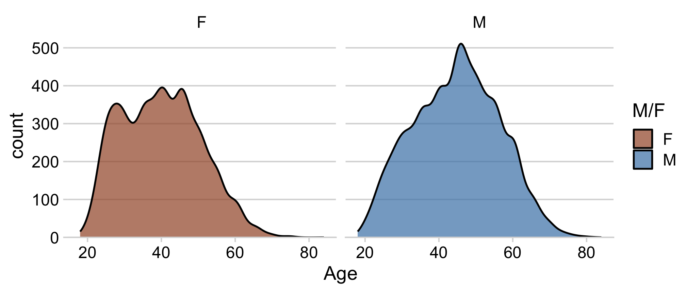{fig-align='center' width=672}
:::
:::


::: {.center .fragment}
If you want the full density overlay,<br>you have to hand-make the facets


::: {.cell layout-align="center"}
::: {.cell-output-display}
{fig-align='center' width=672}
:::
:::

:::
:::

---

## How to make density facets

::: {.col}
Make the full density plot first

::: {.font70}

::: {.cell}

```{.r .cell-code  code-line-numbers="3,5"}
base <- ggplot(
    marathon,
    aes(x = Age, y = ..count..)
) +
    geom_density(fill = 'grey', alpha = 0.7) +
    scale_y_continuous(
        expand = expansion(mult = c(0, 0.05))
    ) +
    theme_minimal_hgrid()
```
:::

:::
:::

::: {.col}

::: {.cell layout-align="center"}
::: {.cell-output-display}
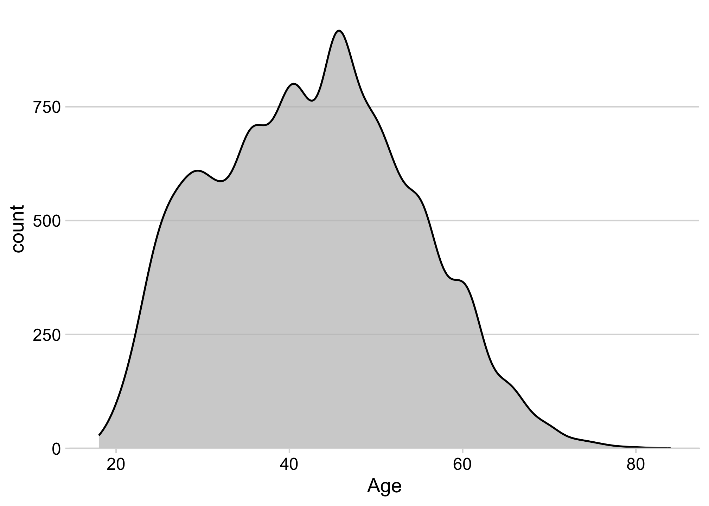{fig-align='center' width=672}
:::
:::

:::

---

## How to make density facets

::: {.col}
Separately create each sub-plot

::: {.font70}

::: {.cell}

```{.r .cell-code  code-line-numbers="3,4"}
male <- base +
  geom_density(
    data = marathon %>%
      filter(`M/F` == 'M'),
    fill = 'steelblue',
    alpha = 0.7
  ) +
  theme(legend.position = 'none')
```
:::


::: {.cell}

```{.r .cell-code  code-line-numbers="3,4"}
female <- base +
  geom_density(
    data = marathon %>%
      filter(`M/F` == 'F'),
    fill = 'sienna',
    alpha = 0.7
  ) +
  theme(legend.position = 'none')
```
:::

:::
:::

::: {.col}

::: {.cell layout-align="center"}
::: {.cell-output-display}
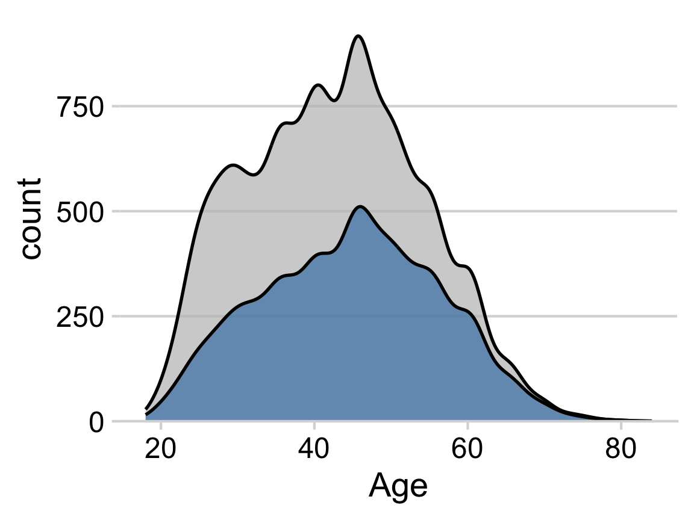{fig-align='center' width=384}
:::
:::


::: {.cell layout-align="center"}
::: {.cell-output-display}
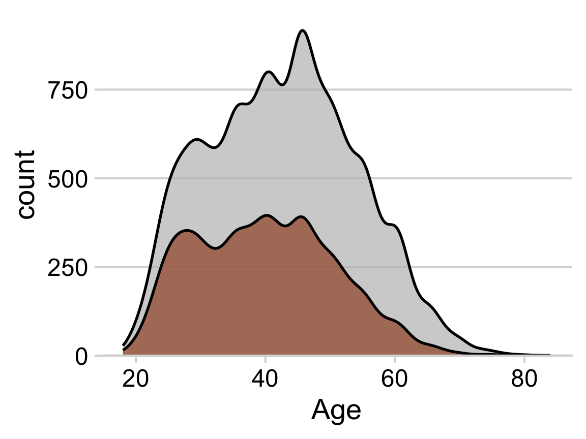{fig-align='center' width=384}
:::
:::

:::

---

## How to make density facets

::: {.font70}
Combine into single plot


::: {.cell}

```{.r .cell-code}
plot_grid(male, female, labels = c('Male', 'Female'))
```
:::

:::


::: {.cell layout-align="center"}
::: {.cell-output-display}
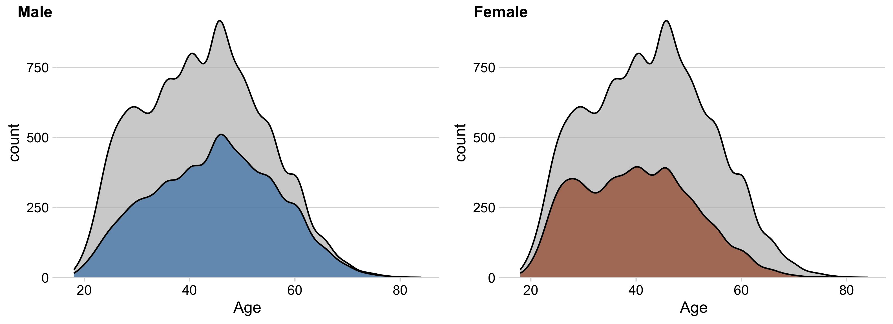{fig-align='center' width=1056}
:::
:::


---

## How to make diverging histograms

::: {.col}
Make the histograms by filtering the data

::: {.font70}

::: {.cell}

```{.r .cell-code  code-line-numbers="4,5,12,13"}
ggplot(marathon, aes(x = Age)) +
  # Add histogram for Female runners:
  geom_histogram(
    data = marathon %>%
      filter(`M/F` == 'F'),
    aes(fill = `M/F`, y = ..count..),
    alpha = 0.7,
    color = 'white'
  ) +
  # Add negative histogram for Male runners:
  geom_histogram(
    data = marathon %>%
      filter(`M/F` == 'M'),
    aes(fill = `M/F`, y = ..count.. * (-1)),
    alpha = 0.7,
    color = 'white'
  )
```
:::

:::
:::

::: {.col}

::: {.cell layout-align="center"}
::: {.cell-output-display}
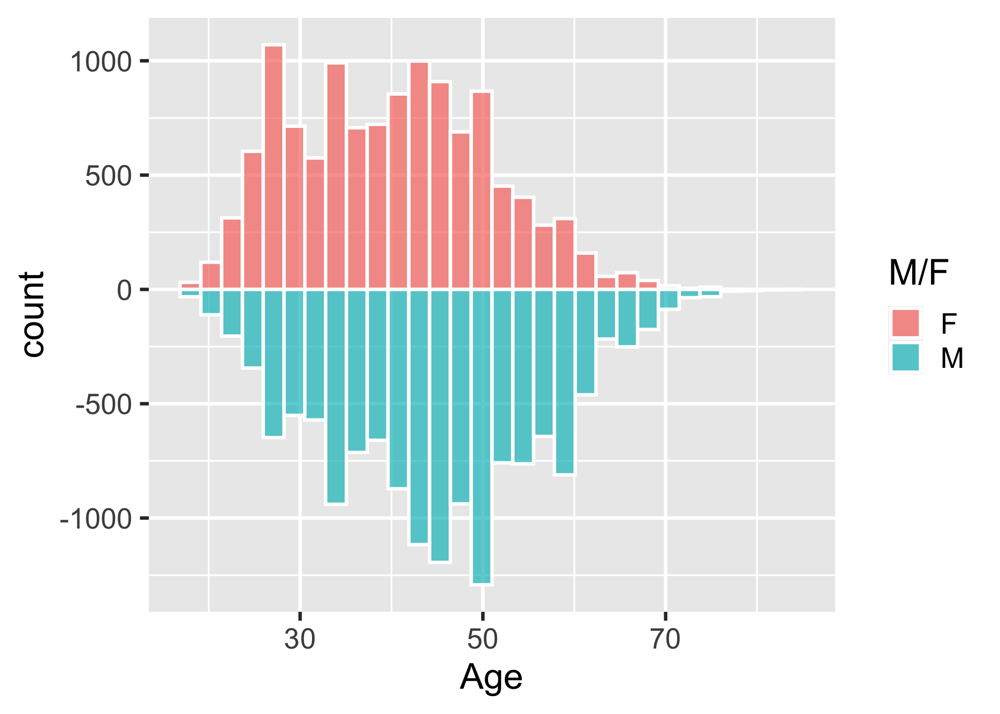{fig-align='center' width=672}
:::
:::

:::

---

## How to make diverging histograms

::: {.col}
Make the histograms by filtering the data

::: {.font70}

::: {.cell}

```{.r .cell-code  code-line-numbers="6,14"}
ggplot(marathon, aes(x = Age)) +
  # Add histogram for Female runners:
  geom_histogram(
    data = marathon %>%
      filter(`M/F` == 'F'),
    aes(fill = `M/F`, y = ..count..),
    alpha = 0.7,
    color = 'white'
  ) +
  # Add negative histogram for Male runners:
  geom_histogram(
    data = marathon %>%
      filter(`M/F` == 'M'),
    aes(fill = `M/F`, y = ..count.. * (-1)),
    alpha = 0.7,
    color = 'white'
  )
```
:::

:::
:::

::: {.col}

::: {.cell layout-align="center"}
::: {.cell-output-display}
{fig-align='center' width=672}
:::
:::

:::

---

## How to make diverging histograms

::: {.col}
Rotate, adjust colors, theme, annotate

::: {.font70}

::: {.cell}

```{.r .cell-code  code-line-numbers="18-23"}
ggplot(marathon, aes(x = Age)) +
  # Add histogram for Female runners:
  geom_histogram(
    data = marathon %>%
      filter(`M/F` == 'F'),
    aes(fill = `M/F`, y = ..count..),
    alpha = 0.7,
    color = 'white'
  ) +
  # Add negative histogram for Male runners:
  geom_histogram(
    data = marathon %>%
      filter(`M/F` == 'M'),
    aes(fill = `M/F`, y = ..count.. * (-1)),
    alpha = 0.7,
    color = 'white'
  ) +
  scale_fill_manual(
    values = c('sienna', 'steelblue')
  ) +
  coord_flip() +
  theme_minimal_hgrid() +
  labs(fill = 'Gender', y = 'Count')
```
:::

:::
:::

::: {.col}

::: {.cell layout-align="center"}
::: {.cell-output-display}
{fig-align='center' width=672}
:::
:::

:::

---

## How to make ridgeplots

::: {.col}
Make a ridgeplot with **ggridges** library

::: {.font65}

::: {.cell}

```{.r .cell-code  code-line-numbers="1,11-15,18,19"}
library(ggridges)

college_all_ages %>%
  mutate(
    major_category = fct_reorder(
      major_category,
      median
    )
  ) %>%
  ggplot() +
  geom_density_ridges(
    aes(x = median, y = major_category),
    scale = 4,
    alpha = 0.7
  ) +
  scale_y_discrete(expand = c(0, 0)) +
  scale_x_continuous(expand = c(0, 0)) +
  coord_cartesian(clip = "off") +
  theme_ridges() +
  labs(
    x = 'Median income ($)',
    y = 'Major category'
  )
```
:::

:::
:::

::: {.col}

::: {.cell layout-align="center"}
::: {.cell-output-display}
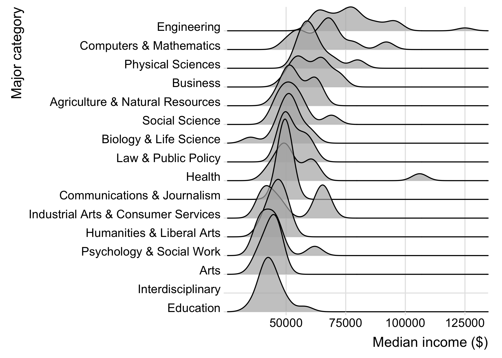{fig-align='center' width=672}
:::
:::

:::

---




::: {.cell}
::: {.cell-output-display}

```{=html}
<div class="countdown" id="timer_660adf80" data-warn-when="30" data-update-every="1" tabindex="0" style="top:0;right:0;font-size:2em;">
<div class="countdown-controls"><button class="countdown-bump-down">&minus;</button><button class="countdown-bump-up">&plus;</button></div>
<code class="countdown-time"><span class="countdown-digits minutes">15</span><span class="countdown-digits colon">:</span><span class="countdown-digits seconds">00</span></code>
</div>
```

:::
:::


## Your turn - comparing distributions

Use the `gapminder.csv` data to create the following charts comparing the distribution of life expectancy across countries in continents in 2007.

::: {.col}

::: {.cell}

:::


::: {.cell layout-align="center"}
::: {.cell-output-display}
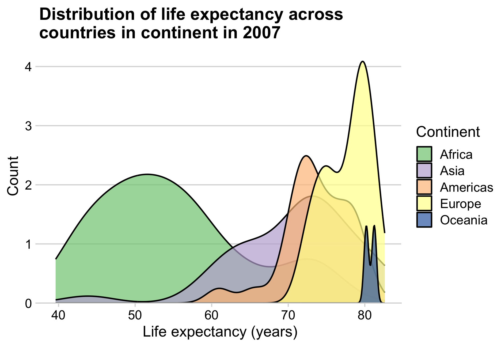{fig-align='center' width=624}
:::
:::

:::

::: {.col}

::: {.cell layout-align="center"}
::: {.cell-output-display}
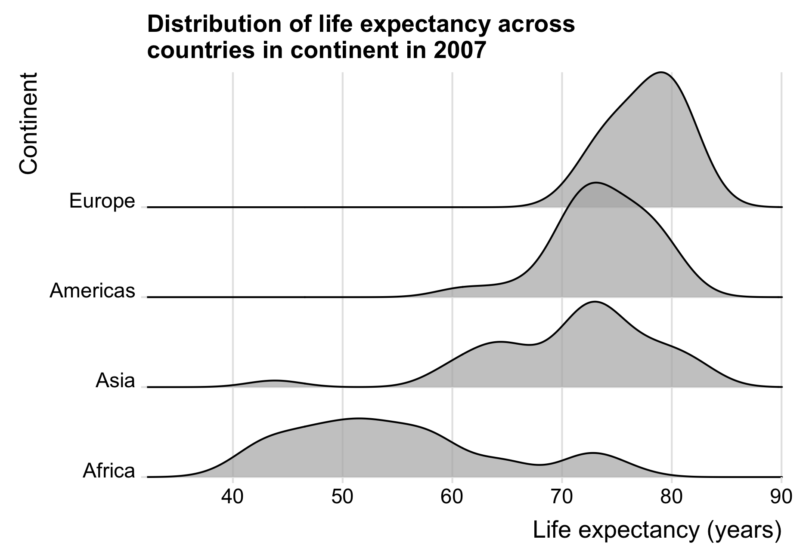{fig-align='center' width=624}
:::
:::

:::

---




# Reminders:

## Your [Mini Project 2](https://eda.seas.gwu.edu/2026-Fall/mini/2-exploring-data.html) is due in 4 days!

## Your [Initial Report](https://eda.seas.gwu.edu/2026-Fall/project/2-initial-report.html) is due in 11 days!

